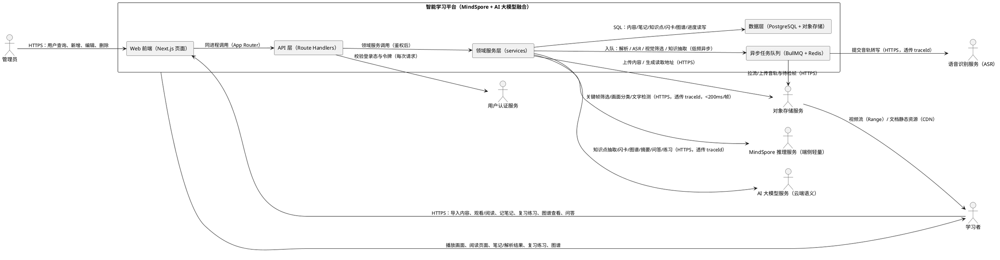
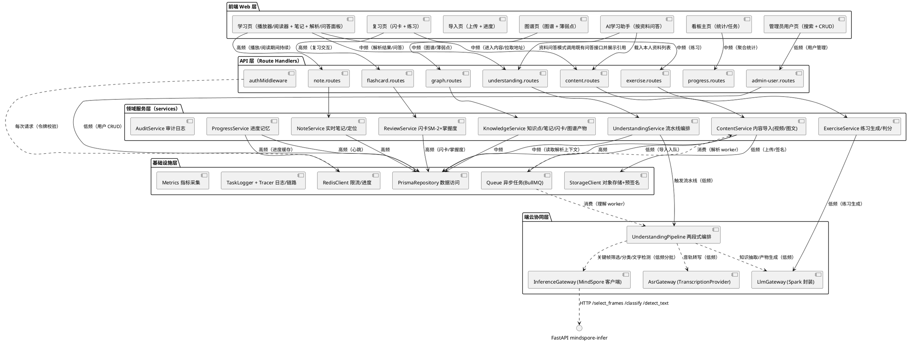
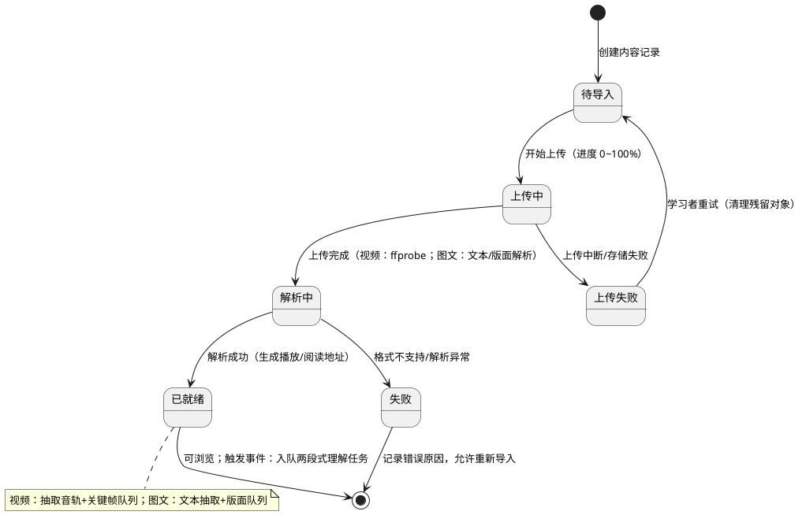
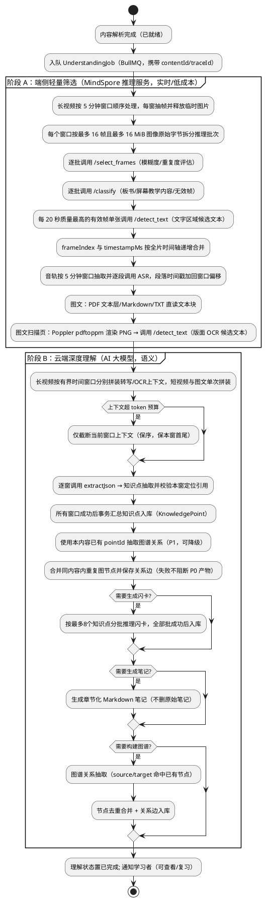
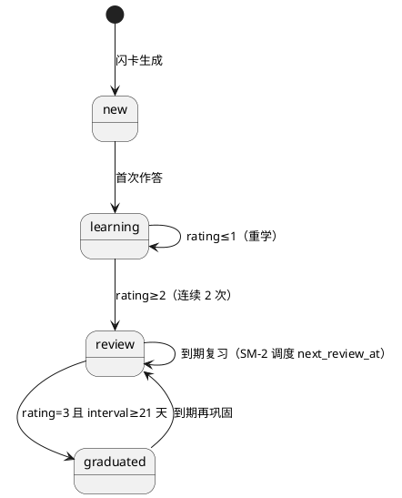
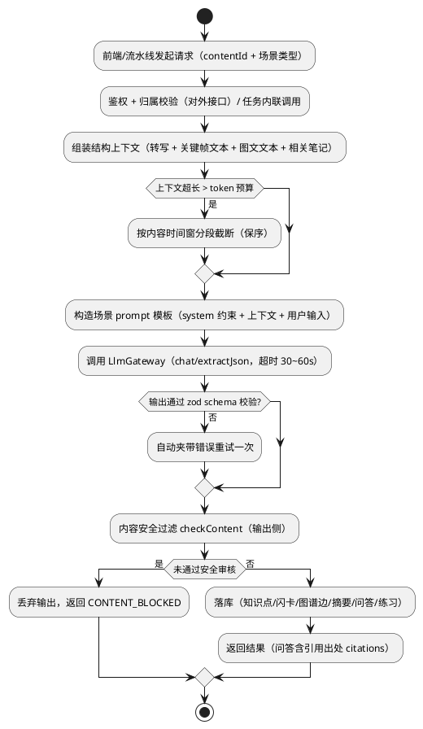
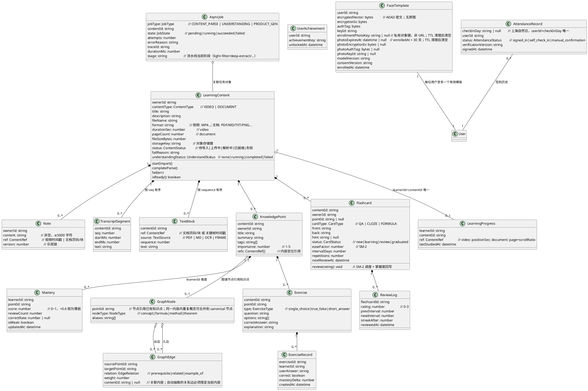

# 基于 MindSpore 与 AI 大模型融合的智能学习平台 —— 实现方案设计

## §29.23 队列可靠性修订（2026-10-21）

上传complete在事务中以可迁移状态原子updateMany认领资料，count=0返回409且不建作业；源对象保留。解析/理解任务使用jobs/dispatch统一入队：异常时锁住资料行，仅将本次仍PENDING的AsyncJob标FAILED，并且只有它仍为该类型最新任务才回退对应PARSING/RUNNING字段，返回503 QUEUE_UNAVAILABLE供本人重试。已经被worker认领或结束时不回退，防止“队列写成功但响应失败”覆盖正在执行/完成的数据。理解入队失败不把已经完成解析的READY资料重新置失败，沿既有understanding/retry重试。

携带asyncJobId的worker必须原子认领成功才执行，数据库异常失败关闭，不再带作业ID降级执行。非终次业务异常在抛回队列前将本次RUNNING恢复PENDING供正常重试，终次标FAILED；无jobId的旧进程内入口保持。这里保证正常投递的互斥/重试，不声称跨数据库与Redis恰好一次；进程崩溃留下RUNNING的人工恢复/持久化outbox仍非本次新增能力。Docker builder/worker及runner显式安装ffmpeg，并构建期探测ffmpeg、ffprobe。

## §29.21 视频直链输入

新增video-imports服务/POST入口，复用URL安全传输与UrlImportDraft状态，视频流式落临时目录、ffprobe本地协议验证后写私有源对象；本人锁内创建VIDEO/PENDING及CONTENT_PARSE任务，提交后入既有队列，成功接收后转PARSING；入队前进程退出仍可手动complete重试。原文档URL接口与Bytes快照保持。前端通过services/video-imports封装，复用链接导入面板入口。失败/取消/维护清理未提交对象，正式视频保留供原解析重试；具体预算/来源/幂等见[34号契约](34-VIDEO-URL-IMPORT.md)，无新依赖/迁移。

## §29.17 三角色服务端边界（2026-10-21）

`User.role` 使用已有字符串列允许 `student|teacher|admin`，不需改表。管理员账号接口负责创建教师及角色调整；自助注册仍固定学生，登录和刷新均签发数据库当前角色。JWT仅识别主体，班级读写在 `classrooms/access.ts` 重查数据库角色及 `Classroom.responsibleId`，教师可创建本人新班级，管理员仅兼容管理自己历史班级。正式提交、附件和批阅复用同一归属判断，不给全局管理员跨班读取权。课程管理沿用 `/api/admin/courses` 后端入口，教师只可操作本人 `publisherId` 副本；管理员治理页只能下架已发布副本。用户管理、签到、举报仍由独立管理员守卫。

## §29.18 教师工作区与平台治理隔离（2026-10-21）

新增 `/teacher/*` 页面路由和 `TeacherShell`，服务端班级/作业 handler 继续以数据库当前角色、班级负责人ID和成员关系作最终授权；客户端壳层只负责入口、身份状态、未登录跳转及友好拒绝页，不替代API守卫。`AppShell` 将已认证教师/管理员从学生主区引导到各自入口。教师课程发布和管理员课程下架在共享课程服务入口复用UI时以角色分支呈现，服务层再按当前角色及发布者/已发布状态限制动作。

`GET /api/teacher/overview` 在单个只读事务中核对当前`teacher`角色，仅查询本人负责班级、有效成员计数、本人任务摘要及`SUBMITTED`数量；返回班级数/任务数/待批阅数、最多50条待批阅任务摘要和最多12条最近任务，不返回提交正文、附件元数据、评语、草稿或学生私有学习数据。路由经`withAuth`和`privateResponse`，前端统一通过`src/services/teacher.ts`请求。

班级/作业现有工作流组件按`student|teacher|admin`入口选择Shell和URL基址，共享业务规则不复制；管理员旧班级入口只保留本人兼容访问，学生流程不变。没有新增表、迁移或运行依赖。当前业务库旧管理员班级数为0，故没有数据移交；`§29.11`最终原生三角色整链仍待完成。

教师侧栏增加`/teacher/attendance`本人打卡与人脸设置入口，复用学生设置组件。模板、挑战、验证、每日状态及普通打卡接口均按数据库当前角色限制为教师/学生本人；全站签到查询仍只允许管理员。管理员的人脸登录在签发会话前被拒绝，教师会话跳转`/teacher`。

## §29.8 智能作业批改与订正（实施契约，2026-10-20）

新增独立`HomeworkGradingReport`，只从本人已`CONFIRMED`的`HomeworkDraft`快照派生；每次最多8题、16,000字符，Spark结构化输出由既有网关最多校验两次。报告、题目快照、逐字依据、规则比对与最多50条订正复核历史单独保存；PENDING/RUNNING/READY/FAILED/CANCELLED状态、幂等键、CAS、固定失败码及取消迟到保护见[32-HOMEWORK-GRADING.md](32-HOMEWORK-GRADING.md)。报告只读本人。客观规则仅做规范选项/判断字符串比对；AI对错建议或百分比与规则结果冲突，以及结论标签与百分制分数自相矛盾时，均降为待核验。AI建议和正式负责人`AssignmentReview`分离，不写班级成绩、`ExerciseRecord`或`Mastery`。`/question-bank`以来源分组列出未完成作业错因并返回原报告，不伪造Exercise。无新角色、供应商、模型选项或依赖。

## §29.4 班级与作业基础（2026-10-19实施契约）

新增十个独立Classroom/成员/邀请/章节/任务/提交/冻结版本/批阅/附件/幂等实体，服务端仅交付只读访问控制与纯状态/输入规则；无新页面、公开HTTP入口或业务写流程。当前数据库角色和班级负责人/成员逐次复核，无全局管理员越权；负责人不读取未交草稿，退出学生仅可读本人已交历史。独立外键/CHECK和迁移保护旧库；后续同班写锁、CAS/幂等、正式版本和附件生命周期均按[28-CLASSROOM-FOUNDATION.md](28-CLASSROOM-FOUNDATION.md)。创建/加入/发布属29.5，提交/批阅属29.6，不以本项实体存在称模块可用。

另补既有账号删除的关联历史保护：目标用户行锁下先检查班级关系，存在则409并保留照片/账号；不提供班级历史硬删除或新管理员私人数据读取权。2026-10-19已完成本地迁移/生成、67项隔离数据库检查与1697项全量测试，见[验收](../docs/acceptance/classroom-foundation-20261019.md)。后续编号为29.5。

## §29.15.3 粘贴正文与学习主线统一（2026-10-19已实施）

学习中心在上传文件/公开链接旁加入粘贴正文，标题与来源说明必填、作者未知留空；预览纯文本后另行确认保存，不访问正文内网址或调用AI。严格POST /api/text-imports preview/confirm，实际请求≤512KiB、正文20–100000字/单段≤20000字/最多20000段，预览前12000字且标总量。User锁、账号命名空间UUID/输入摘要、同事务摘要审计与删除后键墓碑保护；文件确定键补偿核对成功行，失败留输入，同键重试不双写。无新表/迁移/依赖。

复用LearningContent TXT READY/NONE及BookState可选pastedSource（含内部requestId/inputDigest），BookView剔除此字段；resource、ReadingContext、专题SourceCoverage只公开pasteSource白名单，标明本人提供、来源未经原站核验。普通资源响应统一private no-store，原版本/笔记保留。目录先就绪、选段文字与AI各自确认；章节/专题导出保留本人来源和原文/批注边界，专题冻结标注。导入三个面板切换保留挂载/草稿，编辑清旧预览/勾选，保存失败复用原键；桌面左右/窄屏堆叠44px，提示导入→选段→笔记/摘录→专题提问/导出。粘贴不再显示旧整份理解未启动作为导入失败提示。

29.15三子项按既定原文选摘边界完成，不承诺自由改写/全文语义质量；Lite有一次页面2–3段输出校验失败，保留记录且未写假笔记，缩小2–2段独立确认通过。现行权限/预算/DTO/生命周期见[27-PASTE-IMPORT.md](27-PASTE-IMPORT.md)；工程/真实模型/公开HTML/页面与数据保护分别见[本项验收](../docs/acceptance/paste-import-20261019.md)。下一编号29.4班级作业数据与权限基础，未提前实现。

## §29.15.2 专题与范围问答（2026-10-19已实施）

学习中心内部新增“专题学习”/topics，阅读器当前选段可预填来源、明确保存后才提问；没有默认全部私人来源。独立StudyTopic表以本人owner/UUID幂等/revision保护，最多8来源、20专题/人、30问答/专题，归档恢复、冻结引用及MD/TXT导出（包含指定范围原有摘录/个人批注）。只检索BookState已提取单元或既有转写/OCR；1–20页段/最多600秒、每来源1000单元/50万字、总200万字，候选元数据每页50。预览显示覆盖/缺失/版本及最多8个400字逐字窗口；显式确认一次Spark Lite、45秒/2000token/3次每分钟，90秒租约，源变化/取消/迟到拒绝。逐字依据非自由综合推理，不把词命中/JSON当作事实质量全面通过；来源删除保留本人历史快照并标不可回看，管理员无私人越权。

接口GET/POST /api/study-topics、GET /api/study-topics/candidates、GET/POST /api/study-topics/:id，16KiB严格白名单/private no-store，当前账号与本人资料逐项检查；单JSON1MiB、导出2MiB，原表/笔记不迁移改写。桌面左右、窄屏紧凑导航/堆叠/页内跳转、44px操作；失败保留输入、改问题/来源清预览。无新增依赖/训练/其它供应商/班级共享。具体数据/动作/预算与验收见[26-STUDY-TOPICS.md](26-STUDY-TOPICS.md)及[验收](../docs/acceptance/study-topics-20261019.md)。29.15父任务仍未完成，下一29.15.3粘贴正文与主线统一验收。

当前型号追加修订（2026-10-18用户明确指令）：默认SPARK_MODEL=lite，保留星火凭据和其它配置。generalv3.5真实11200阻塞不核销；本轮Lite有界原文笔记验证另记，不称通用语义推理质量全面通过。此前型号记录作为历史保留。

## §29.15.1 章节原文笔记与摘录批注（当前实施）

本次只在已有BookReader中提供选段星火原文笔记、划选高亮/个人批注与标签、移除恢复及本页Markdown/TXT导出。BookState增加可选readingJournal，bookView剔除journal，原目录/正文/个人Note和GeneratedNote保持；同一User锁及bookRevision CAS合并，生成单次45秒/4500字/2000token、90秒租约和逐字位置校验，确认前不发送模型，失败不伪造摘要。新API GET/POST /api/contents/:id/reading-notes，本人隔离/private no-store、32KiB请求、每份100条/1MiB，严格动作/冲突/取消与幂等；详见[25-READING-NOTES.md](25-READING-NOTES.md)。专题/粘贴与跨来源问答留29.15.2/29.15.3，父29.15未完成。暖纸张卡、44px操作、纯文本mark与范围/实际引用提示；折叠保留挂载和草稿，切章不重绑已选摘录。

## §29.14 公开链接预览与确认保存（2026-10-18实施）

仅HTTP(S)默认80/443端口、公开静态HTML/直接PDF；不带浏览器Cookie/Authorization/Referer，不执行JS或加载文章子资源。DNS每跳验证全部IPv4/IPv6为公开unicast，连接固定本次批准IP并复核remoteAddress，禁止环回/私网/链路本地/元数据/保留/映射特殊网段；最多3跳且HTTPS不降级HTTP，绝对总下载30秒。仅identity编码，HTML≤2MiB/PDF≤10MiB，按实际流字节限额并核对Content-Length，不能只信声明。

HTML通过htmlparser2@12转纯文本Markdown，优先article/main并移除导航/脚本/表单/隐藏和嵌入资源；正文至少200字、至多10万字/5万节点/64层，拒绝登录/视频/网盘入口及高链接密度/没有可靠正文的页面。PDF用既有PDF.js目录/真实页数与前3页文本预览，不自动OCR或AI。预览最多12000字，明确实际范围，不能称全书理解。

新增UrlImportDraft：本人+requestId幂等，FETCHING/PREVIEW/FAILED/CANCELLED/EXPIRED/COMMITTED；最多3条活跃预览、6次新获取/分钟/用户，30分钟有效，缓存净化正文/PDF快照Bytes≤10MiB，原HTML不保留。新LearningContent.urlSource为不可变来源JSON：请求/最终URL、实际标题/作者/发布日期（缺失为null）、获取时间、原始/内容SHA256、前版ID。确认只读已缓存快照，不再次抓取。用户行FOR UPDATE串行确认/取消/重复判断，原content和引用不更新；相同请求返回同一个资料ID。对象键由草稿ID确定，数据库失败在同一用户锁下补偿，过期维护可复原处理孤立对象。

POST /api/url-imports {requestId,url}获取预览；GET/DELETE /api/url-imports/[requestId]读取或取消（已保存返回冲突，不删除资料）；POST /api/url-imports/[requestId]/confirm {confirmed:true,mode:reuse|new}复用相同URL+内容摘要的本人资料或显式新版本。private no-store；请求≤4KiB，字段/错误白名单，不回显任意网络/解析异常或向日志写URL查询串。管理员不越本人范围。

确认创建READY的MD/PDF资料及已有BookState，正文/AI覆盖仍从0开始，只在阅读时选段。预览是临时缓存不计资料、确认后原快照版本不可自动刷新；从原链接显式重新预览并保存新版本才更新，旧ID/笔记不重指。主学习中心加入文件/链接切换，预览须可读、可取消/重新核对；学习页显示来源与获取时间。无章节AI/粘贴/专题/班级或训练。过期在本人下次访问时清理，另提供有界维护脚本；未安装定时任务不能称自动定时清理。协议及存储生命周期见24-URL-IMPORT.md。


## §29.13 EPUB首版实施契约（2026-10-18）

在原学习中心文档入口支持EPUB，≤50MiB。服务端验证ZIP中心目录/本地头、CRC、压缩方式、路径和预算，ZIP64/多盘/加密/DRM拒绝；不解包到磁盘、不读取包外文件。最多2000条目、单条4MiB、累计解压32MiB、压缩比200、XML深度64/10万节点、正文200万字/2万段/200个spine项目，每段≤2万字，超限整次失败而非截断成功。仅文本层阅读，不支持复杂排版/图片/公式呈现；不加载远程资源或执行脚本。

读取container.xml→OPF manifest/spine，导航EPUB3 nav优先、兼容EPUB2 NCX，真实锚点映射到全局稳定段号；无可靠导航明确按spine阅读顺序，未解析目录不猜。新增BookState.format=EPUB与epub-nav/epub-spine来源，复用已有BookState JSON/CAS与20段选取、50万字保存预算，无迁移。书籍上传验证后READY且自动建立目录；units仍空，选定范围后才保存正文，不入全书TextBlock或自动UNDERSTANDING，AI仍NONE。首版章节AI留29.15。

ContentRef沿用document+page=1+blockIndex（全书从0开始的稳定段号）兼容信封，EPUB不展示/推断固定页数，pageCount=null；ContentSummary仅EPUB增加可选format=EPUB，笔记接口以BookState.unitCount核验page=1和必需blockIndex边界，不借假页数通过校验。手工目录修改不改变段号；源哈希变化拒绝提取，需新资料ID重新导入。章节内位置可由目录范围对应；书签/引用/个人草稿与旧PDF/TXT/MD保持。EPUB笔记隐藏无意义页码编辑，明确全书段号；原始EPUB不放iframe。

仅新增saxes@6.0.0（ISC）严格XML事件解析及其xmlchars依赖；拒绝实体/外部DTD，仅允许不含外部标识的DOCTYPE html，解析错误统一固定提示，不输出书内路径/文本。ZIP采用Node zlib有界inflateRawSync与crc32，不引入ZIP解包器。详见23-EPUB-READING.md，URL/专题/章节AI均不在本编号。


## 现行模型契约：§29.12.1 统一星火（2026-10-18用户修订）

全部文本AI仅使用讯飞星火，删除OpenAI运行分支、凭据入口与部署配置；默认LLM_PROVIDER=spark，不支持其它供应商。沿用本机已选generalv3.5，不自动升级型号、回退或重跑已有资料。笔记/问答/Agent/抽取共用spark.ts，ASR、MindSpore及人脸独立保留。JSON指令与response_format并用，按型号限制输出预算，关闭支持型号的内建联网搜索；原Zod、引用及事实保护保留。AGENT_REVIEW_READY=false不因切换变true，AGENT_REVIEW_THINKING仅是显式开启逐句覆盖/术语复核的内部开关，不表示模型具备隐藏推理或已通过教学质量验收。无新表或API路径，EPUB摘要有可选format字段，ChatResult和安全错误保持；真实短请求与教学质量分开验收。旧OpenAI说明及失败记录仅为历史，当前以[22-SPARK-ONLY.md](22-SPARK-ONLY.md)为准。


§29.12实施契约：新增lib/books/contracts（纯严格校验/定位）、source（现有PDF.js及UTF8原文读取）、service（本人隔离/CAS/有界持久化）、services/books及study/BookReader。LearningContent仅加bookState可空JSON和bookRevision默认0；旧导入/文本块/笔记/产物不自动改写，无后台AI或全书重跑。JSON为首版有界阅读索引，最多200章节/100书签/2000PDF页或20000文本段、20单元/次提取、单单元20000字符、累计500000字符；超限整次不提交，不截断后谎报成功。PDF只对选定页取文本，扫描/空白页标待OCR；TXT/MD分段与旧parser一致，保留page1/blockIndex定位。内置PDF目录失效或超限退为明确页段，不编造书目。源文件最多50MiB，原文件读取与PDF解析各30秒预算；源文件SHA256不可变绑定、请求键有界保留32项，修改expectedRevision CAS，冲突保留草稿。元数据GET不读取原文件，提取时重新校验哈希；源文件改变拒绝继续，重新导入新资料，不改旧索引。

§29.3实施契约：删除试卷专属客户端工作区/HTTP客户端及服务端读写/生成实现，保留无I/O的历史契约/校验/客观评分纯逻辑和数据库迁移。旧八页面仅渲染共用ExamRetiredPage；19条试卷API通过统一examRetiredResponse返回无数据的410，不导入鉴权/数据库/队列/模型。PRODUCT_GEN仅stage=exam-generation的旧载荷直接完成丢弃，包括未知ID/重复消息，不读取旧任务、不重试/恢复/记成READY或CANCELLED；其它stage继续原处理器。旧QUEUED/RUNNING记录只作历史原状态，不能解释为仍在生成。删除工作进程生成实现后，已有进程需重启切换新构建；不能声称任意未更新的远端旧进程已停止。旧请求/幂等回放同样410，迟到结果不存在写入/成卷入口，后台不再消费模型。原数据不修改，不新增迁移/历史查询或导出接口；后续归档另做权限契约。演示prepare/walkthrough及生产烟测移除主动考试步骤，保留所有历史验收报告。

§27.8.1 星火JSON模式修正：spark.ts对显式jsonMode发送response_format=json_object（原来仅百炼/智谱发送而漏掉星火），并像百炼一样补JSON文字约束；不修改调用者消息，普通文本无该参数且不改消息，不增加重试/切模型。generation-worker提示补完整嵌套结构/英文type与必填字段，现有候选schema/引用/去重/调用预算不变。只新增离线调用的一次性自编诊断CLI，不新增公开API、DTO、数据表或依赖。真实Lite输出依然非法，详情见docs/acceptance/spark-json-diagnostic-20261016.md，不能将参数修复等同整卷质量通过。

§27.9 新generation-paper-contracts/service负责本人草稿安全预览与确认成卷，GET options/preview、POST paper通过sharedRoute，前端services/exam-generation，ExamGenerationWorkspace仅页面状态/串行只读轮询，不直接Prisma或fetch。确认User共享锁→本人job独占锁→BANK管理锁，重查来源/审核/摘要与配额，事务内私人ExamPaper/封卷快照/AuditLog唯一确认；不同请求键并发也只建一份，不接受客户端候选内容。已确认任务禁止继续生成/取消。student-service公开目录保持PUBLIC，仅详情/开考增加本人PRIVATE，现有保存/交卷/结果不放宽归属。窄范围迁移20261016120000_exam_private_reference仅扩展开考referenceOnly校验为AI_MOCK或PRIVATE，无新表/依赖，公开正式卷与旧答卷不改。

§27.8 后台新增 exams/generation-contracts（严格蓝图/候选/安全状态）、generation-store（本人事务/原文快照/DB时钟）、generation-service（幂等创建、受控恢复/取消）、generation-worker（固定批次、租约、预算与校验）。薄路由/api/exam-generation-jobs及/:id经sharedRoute；前端只经services/exam-generation。复用PRODUCT_GEN的stage=exam-generation和既有ExamGenerationJob/Batch，无新表/迁移/依赖。调用前原子保留次数，5题/批、2次/批、总2×ceil(N/5)、10分钟墙钟/45秒请求/120秒租约。取消持久化后本进程AbortSignal尽力中止，其他进程和迟到响应凭状态/租约丢弃；失效租约显式恢复，不靠GET驱动。BANK不调用AI，当前审核池与管理写串行；AI仅星火，无隐式付费备援。私人候选/答案只在服务端，完整语义质量与27.9页面未通过/未实现。详见17实施契约。

§27.6 student-service增加answerSave/attemptSubmit，两条sharedRoute薄路由PUT answers、POST submit，services/exams集中封装。User共享锁后仅本人答卷FOR UPDATE串行写；整卷revision CAS与AuditLog摘要/安全确认结果同事务，重放不重复写/评分。保存按冻结题型验证，DB时钟与现有trigger同时拒绝过期；提交不接收答案，先SUBMITTED再写客观逐题分数，最后同事务GRADED或PENDING_REVIEW。attempt-scoring纯函数做固定key集合/布尔全额客观判分，主观一律pending；不写XP/旧Exercise。安全DTO交卷后仅增加聚合gradeSummary，仍不泄露逐题判分/答案/解析。ExamAttemptWorkspace独立组件管理本页未确认草稿、失败保留、单次到期提交和部分成绩。无新表/迁移/依赖/模型请求，详见17实施契约。

§27.7复核修正：grading-service事务内先对答卷FOR UPDATE（读取FOR SHARE）再读同一快照，和交卷/多管理员写互斥；grade输入去重题ID，按所有冻结主观题计算尚未批阅满分及已评分，不按现有答案行推断题量。result读取同样共享锁保证聚合与逐题一致，摘要函数仅依赖ExamAttempt标量与必要版本元数据。新增20261016100000_exam_blank_grading增量迁移保留原迁移，允许已交待批主观题创建严格SQL NULL空评分载体，不允许迟交文本/标记/分数，同时冻结最终逐题分。无新表/字段/依赖/AI请求。

§27.5 新student-contracts/student-service为学习者公开目录/说明/本人答卷白名单及有界查询，五个薄路由复用sharedRoute鉴权/no-store；前端services/exams封装HTTP，ExamWorkspaces读写分开，动态params在Next16服务端页面await。新开考事务User共享锁→按本人advisory锁→父卷共享锁，和发布/下架父卷独占锁互斥；DB时钟与固定题序/随机一次选项序写入ExamAttempt，AuditLog请求别名同事务去重。旧未交/到期答卷不重置，已有本人快照不被改版/下架替换，管理员也无跨人读取豁免。toAttemptQuestion和本人答案白名单不回传评分/原source/body；列表/说明不含题干。无新表/迁移/依赖/模型请求，写答案与交卷留27.6。细节见17。

§27.4 新增paper-contracts纯蓝图/命令/最大匹配分配与paper-service当前审核候选/预览摘要/封卷快照/发布指针服务，薄路由/api/admin/exam-papers经sharedRoute。services/exam-papers封装HTTP，ExamPaperWorkspace与AdminShell接入管理员页面。复用27.3有界输入、当前角色事务、低频管理advisory lock及AuditLog幂等，与题库审核/修订串行；父卷行锁与revision CAS。预览无写，完整且重验摘要才存分区/题目快照后seal；修订新增版本不变旧发布指针，发布重验题源。无新表/依赖/迁移、模型调用或学生答卷接口，具体见17。

§27.3 管理题库已接入三个薄路由 `/api/admin/exam-subjects`、`exam-questions`、`exam-import`，复用sharedRoute的withAuth/no-store；bank-service事务内锁定当前User角色与共享题，PRIVATE题完全排除。bank-contracts提供严格命令/模板解析，前端services/exam-bank统一HTTP，AdminShell新增科目与题库。题干修订追加版本，审核CAS、启用检查分类/最新审核，删除为停用。低频管理写使用事务advisory lock，AuditLog唯一摘要ID兼做幂等结果，写入和审计同事务，不增依赖/表，不触发模型。JSON/CSV预览无写、确认重新校验/摘要核对/整批事务，详见17；27.4已实现题库组卷与发布，学生答卷和AI服务仍未开放。

§27.2契约先落地：独立试卷领域基础见[17-EXAM-FOUNDATION.md](17-EXAM-FOUNDATION.md)。新Exam*模型/版本快照/整卷答卷及预算与纯校验位于src/lib/exams，原Exercise/Mastery不改；分数用整数百分单位，复合FK限制题目/答卷同卷，已封卷/题目版本内容不可原地改。DTO显式投影隐藏答案；27.2本身未开放接口，27.3管理题库见上方最新状态，发布/开考/评分/AI任务仍留后续编号。迁移及实际验证状态最终记录PROGRESS，不把基础约束当页面/AI验收。

§26.12补充：原文精选单选的本批同一标准答案保守避重，忽略空白和尾句号，DUPLICATE_FACT白名单诊断；在每题纠错和最终整批写入前均校验。其余题型及历史题不受该规则影响，不冒充通用语义去重。题库数量为前端1/3/5选择、默认1，仍经services.api显式提交原count；没有部分保存、额外AI重试或新接口。唯一真实5题后人工未通过，补强仅用记录输出离线回放，不追加真实调用。

§26.12实现前：仅改现有exercises/generate内部选择题契约，优先两个具名内容字段，服务端一次确定选项位置并映射correctAnswer，然后走原questionSchema与事务。每题仍extractJson最多2次、整批最多count×2，不增加额外修复调用；明确弃答立即停止。将本批同知识点已有题干/答案作为私有排重上下文，不查跨用户题库，不发送日志。保留旧模型响应兼容，无新依赖/表/公开DTO。

§26.11实现前契约：视频新知识点改为AI选择本窗连续原文来源，服务器恢复原文摘录及真实时间，标题明确“原文精选”而非已核验定义；不使用旧摘要或个人笔记作为事实。保留相邻上下文、未知编号/无依据拒绝，不纠正ASR术语或推断单射/满射结论。失败先于原产物替换；旧视频不自动重跑，隔离副本验收。公开字段/表不变，摘录忠实不等于转写或教学事实准确。

§26.10：AI网关新增schema-diagnostics白名单投影，AiError携带可选结构化诊断，extractJson仍最多两次、不输出解析异常片段。exercises/generate仅将固定原因/字段/规则与traceId交给错误响应及taskLogger；模型弃答是内部严格结构，不写题目。新增有限元评价选项拒绝，保留整批事务。无业务表或成功DTO变化；当前映射视频出题质量未通过，来源忠实性留26.11。详见docs/acceptance/exercise-quality-20261016.md。

§26.5/26.6用户明确要求一轮解决两个已有问题，按spec/15-FINAL-REPAIRS.md顺序实施：Next16.4.1/React19.3.1安全升级，鉴权HOC边界await动态params、客户端URL参数读取及Webpack/flat ESLint适配，不改公开API/权限。总图谱正确率按本人实际作答次数加权，复习次数保持原义；无作答null与零正确0分开，无新表/字段。历史章节中的Next14/React18为迁移前基线，以本段和package锁定版本为当前实现。

2026-10-15 §25.10修复25.9发现的权限缺陷：src/lib/auth/ownership.ts的assertOwnership及findForeignResources对全部角色严格匹配owner，取消JWT admin的私人资产豁免；批量缺失userId失败关闭，403不透传owner内部ID。现有私人读写调用点统一生效，计划/聚合/图谱已有本人查询约束；管理员专用用户/签到/共享发布/讨论管理保留独立权限。98项隔离真实HTTP验证通过，字段/表/接口未新增，具体契约见[13-PRIVATE-OWNERSHIP.md](13-PRIVATE-OWNERSHIP.md)。25.9整体验收需另轮复验，正式门控仍关闭。

§25.8新增src/lib/discussions/notifications领域服务与Notification；回复通知及举报事件/通知/审计均与业务同事务，幂等unique eventKey，自回复不通知。接收人User共享锁在课程/主题之前，消息读取及已读用本人User独占锁与写入串行，再读DB时钟asOf；后续通知加1ms避毫秒截点等号，不采用旧事务起始时间冒充到达时间。参与列表当前发布/可见父链、本人发布或可见回复，消息DTO固定摘要/本人结果/当前可用目标，无旧正文/内部身份。sharedRoute/no-store薄路由、services对象请求、MessageWorkspace/MessageLink及课程thread定位接入，正式默认关闭，详见11。

§25.7：src/lib/discussions/moderation与moderation-contracts统一管理/举报校验；API薄路由sharedRoute/withAuth/no-store，管理员路由先assertAdmin，事务再核对当前数据库角色。User共享锁→课程→主题→回复/举报行锁与CAS；处理举报先锁接收人User避免删号级联竞态，处理/结果事件/审计同事务。DiscussionReport部分唯一待处理目标索引与reporterId/requestId去重，跨课程唯一冲突转409；DiscussionEvent仅关联和固定类型，不保存旧正文/私密原因。AdminShell/services及DiscussionReports组件实现，25.8通知入口仍未实现，正式门控默认false。详见10。

§25.6已实现（契约先于代码）：src/lib/discussions统一纯文本/定位/幂等/CAS及User→课程→主题锁；API复用sharedRoute鉴权无缓存，services封装前端，CourseDiscussion仅共享课程范围。User删除匿名化在数据库触发器保护所有路径，管理员讨论管理/举报已于25.7实现，通知留25.8；默认DISCUSSION_RELEASE_READY关闭，详情只在门控开启时暴露讨论入口。契约见09。

§25.5已实现（契约先落地）：详见08-SHARED-COURSE.md；src/lib/courses承担快照白名单、独立媒体准备/失败清理、本人管理员/发布状态和CAS事务，sharedRoute复用withAuth及统一响应并强制no-store，API薄路由委托该适配器，services封装前端调用。CourseReader不复用会写私人进度/笔记的Study组件。StorageClient流读写支持内部contentLength，无外部直链。SharedCourse独立迁移，源/发布者删除SetNull；原getCurrentUser的Cookie兼容修正为给原始access JWT补Bearer格式再校验，显式Authorization优先、刷新JWT仍拒绝。讨论/回复在25.6迁移；举报/通知后续迁移。

§25.4：/notes通过services.api.personalNotes读取跨资料分页，GET /api/notes以Note和lesson双重本人归属约束并复用toNoteItem。前端编辑/删除/按资料导出沿用原服务，来源回看复用studyCitationUrl；列表effect守卫拒绝迟到读取，写操作同步互斥且失败保留输入。不新增表或模型调用，具体契约见04 §25.4。

§25.3导航范围：学习页下一步链接携带contentId；计划/助手只在本人既有列表中验证预选值，显式非法/重复/不可用值不自动换另一资料。目标query变化以页面workspace key隔离，重挂载丢弃旧页面会话并使原助手active守卫拒收迟到回答，防止同路由切资料时旧回答进入新范围；同范围重读保留本人手动选择。仅前端导航参数，不新增API/DTO/表。学习页快捷按钮只改现有笔记面板显示或打开原details并滚动，不重挂载播放器/WatchedNotes/PlaybackNotes，不在点击时调用模型。

§25.2实现增量：LearningGuide为纯页面展开状态组件，不写账号/进度、无独立fetch，刷新重置；Dashboard仅在既有contents成功后挂载，确认空库时initiallyOpen=true，读取失败/未知不冒充新用户。/help通过现有AppShell复用登录/profile读取，静态说明及既有模块链接不调用模型。导航分组和顶栏链接仅呈现，无新API/DTO/表/依赖，AdminShell保持独立；该编号仅导航；共享/讨论随后由25.5/25.6实现。

## Phase25 共享与交流架构增量（共享只读已实现，交流待实现）

2026-10-14 §25.1：详细边界/规划模型/路由/状态/事务见[07-LEARNER-INTERACTION.md](07-LEARNER-INTERACTION.md)。SharedCourse为管理员本人授权资料的独立发布快照与独立媒体副本，不给原LearningContent添加全站可读捷径，不放宽原ownership。首版共享课程只读与讨论；原个人笔记/成绩/问答仍在原空间，公开DTO不得透传个人产物或源对象键。

共享媒体新路由逐请求认证及published校验，服务端流读支持Range/no-store，本地及S3不下发公开/外部直读URL；下架拒绝后续读取，已交付字节无法撤回。领域服务承担发布副本、访问、讨论/举报/通知事务，前端通过src/services、API鉴权后编排，不在组件直fetch/Prisma。仅作者可改正文，管理员管理动作独立，版本冲突不覆盖，创建requestId去重。

回复与主题作者通知、举报处理与结果事件同事务/唯一eventKey去重；状态变更与写入竞态检查当前课程/主题状态。消息不存旧正文，隐藏/删除/下架时动态目标不可用；正式讨论须管理/消息闭环完成。新增模型和迁移在25.5–25.8逐编号落实，表总数与现有接口不因规划被核销。本编号未改数据库/代码/部署/依赖。

§24.2ReviewWorkspace以页面状态保存仅成功api.review响应对应的{card,rating,nextReviewAt}快照，完成后交ReviewNextSteps显示自评/下一步及原接口排期。不新增公开DTO/表/SM-2算法，不读取额外AI/题库计数，不声称入口一定有题。失败不追加，原提交锁/会话计数保留，范围切换重挂载清空。日期显式Asia/Shanghai格式化，无效值只显示未知。

§24.1 ExercisePracticeGroup以初始questions快照建立当前轮清单。wrong仅由当前轮results的成功判分构造；显式重练设置下一轮清单、上一轮统计与轮号，清空answers/results/redoing/index/feedback，不新增API或表、不改answerExercise/掌握算法。每轮复用已有提交互斥和迟到响应保护；退出/重载仍清空本页轮次，已提交ExerciseRecord保留。题库与助手的共用组件同样适用，助手按既有runId重挂载。

§23.12学习页PDF页图/上传图片使用Next Image的unoptimized模式，浏览器继续请求原签名URL并走既有私有存储鉴权，不经过/_next/image公共优化缓存；width/height为组件必需尺寸提示，CSS双auto保持实际原图比例及原最大尺寸，主阅读图片loading=eager/decoding=async。不新增元数据接口、远程域名白名单或缓存，不宣称图像压缩收益。

§23.7真实播放发现模型改写keyword/超过30字导致第二批失败：随看私有模型输出收敛为points[{sourceNumbers}]，不再要求生成关键词。服务端以“原文要点N”为固定标题，保持连续及邻接原文摘录、来源/预算/安全校验；未知关键词/摘要字段仍拒绝。SCHEMA_INVALID向页面返回固定中文重试提示，不暴露Zod路径与英文细节，其它既有供应商安全错误原因保留。公开响应及存储字段不变，取代§23.6的私有keyword契约。

> 课题：基于 MindSpore 与 AI 大模型融合的智能学习平台设计与实现
> 本文档目标：将新课题统一边界与需求（WHAT）转化为可落地的技术设计（HOW），重点体现「MindSpore（端侧/轻量）承担视觉感知与实时筛选、AI 大模型（云端/语义）承担深度理解与内容生成、两者端云协同」的核心架构亮点。
> 关联上下文：`.codeartsdoer/specs/video_notes/`（原 spec.md 已作废删除，本文档为项目唯一实现方案设计，即本文件 `spec/03-ARCHITECTURE.md`）。

# 一、需求与存量功能关系分析

§28.2/28.3（2026-10-18）独立工具`services/learning-lora`：28.2固定版本/源码、隔离原创样本、检查token及随机LoRA；28.3按固定预算增加基础权重下载校验、真实MindRecord/assistant-only训练、仅适配器导出/基座冻结与新进程重载、相同heldout及星火单次对照。它不进入Web/worker、不新增HTTP/DTO/数据库或修改模型路由；页面接入仍属后续任务。软件/存储/证据边界见[19-LEARNING-LORA.md](19-LEARNING-LORA.md)，小样本自动检查或loss下降不能当作课堂、多学科或通用能力提高。

§28.1（2026-10-18）覆盖下方供应商历史描述：全部文本模型统一由既有`src/lib/ai/spark.ts`网关（保留文件名兼容调用方）按`LLM_PROVIDER`路由，默认OpenAI gpt-6-luna/medium的Responses API，星火仅显式手动备用。移除智谱/百炼及分场景选择，不改MindSpore/ASR、业务HTTP契约或数据库。完整请求/响应/输出预算/错误/凭据边界见[18-OPENAI-MIGRATION.md](18-OPENAI-MIGRATION.md)，旧模型验收不作为新模型通过证据。

## 1.1 需求功能与存量功能对比

### 1.1.1 已实现功能

**现状结论（2026-09-09 核实）**：当前 `main` 分支工作区（HEAD `035bae9 删除所有内容从新来`）已进入落地阶段，**工程骨架、数据模型与基础基建代码已就位**，但业务路由、MindSpore 推理服务与前端页面尚未实现。**本课题已从「绿地」转入「骨架已建、待填业务」阶段**，无需再从历史分支整体迁移。

> 说明：历史分支 `origin/feat/zhiliao-v1` 仍保留「知了 AI 学习平台」的早期工程与文档，其中部分能力已被吸收进当前工作区（见下表「已落地」列）。当前工作区为**精简重传后的独立工程**，与历史分支解耦。

| 需求功能 | 当前落地状态 | 代码位置（当前工作区） | 状态 |
|---------|---------|---------|------|
| 数据模型（43 张业务表 + 27 个枚举） | ✅ 已完成 | `prisma/schema.prisma`：初始 16 张（User/LearningContent/Note/TranscriptSegment/TextBlock/KnowledgePoint/Flashcard/ReviewLog/Mastery/GraphNode/GraphEdge/Exercise/ExerciseRecord/LearningProgress/AsyncJob/AuditLog）+ 迭代新增 27 张（LiveSession/SharedCourse/LiveChunk/Discussion 相关 4 张/Notification/GeneratedNote/UserAchievement/LearningPlan/Face 相关 3 张/Exam 考试域 13 张）。完整字段见 `spec/04-DATA-MODEL.md` | 已落地 |
| 统一 API 响应格式 | ✅ 已完成 | `src/lib/api/response.ts`（`ok()/fail()/HttpStatus`） | 已落地 |
| 集中错误码 `ErrorCode` | ✅ 已完成 | `src/lib/api/errors.ts`（ErrorCode 枚举 + ErrorHttpStatus 映射） | 已落地 |
| AI 大模型网关 | ✅ 已完成 | `src/lib/ai/spark.ts`（`chat()/extractJson()/AiError`） | 已落地 |
| AI 内容安全过滤、输入清洗 | ✅ 已完成 | `src/lib/ai/content-guard.ts`（`checkContent()/sanitizeInput()`） | 已落地 |
| API 限流 | ✅ 已完成 | `src/lib/api/rate-limit.ts`（Redis + Lua 原子计数，按接口分级阈值） | 已落地 |
| 用户认证与 Token | ✅ 已完成 | `src/lib/auth/jwt.ts`、`password.ts`、`middleware.ts`、`ownership.ts`、`session.ts`、`code-store.ts`、`src/app/api/auth/{register,login,send-code,logout}`（真实 DB 校验 + JWT + 限流） | 已落地 |
| 统一内容定位 `ContentRef` | ✅ 已完成 | `src/lib/domain/content-ref.ts`（video/document 判别联合 + zod + 区间校验） | 已落地 |
| 异步任务框架 `AsyncJob` | ✅ 已完成 | `src/lib/jobs/async-job.ts`（create/start/succeed/fail/updateStage/getLatest） | 已落地 |
| 结构化任务日志 `TaskLogger` | ✅ 已完成 | `src/lib/jobs/task-logger.ts` | 已落地 |
| Redis / 队列封装 | ✅ 已完成 | `src/lib/redis.ts`、`src/lib/queue.ts`（BullMQ + memory 双驱动）、`src/lib/jobs/workers/*`（三队列 worker 脚手架）、`src/lib/prisma.ts` | 已落地 |
| MindSpore 端侧推理服务 | ❌ 未开始 | `services/mindspore-infer/`（FastAPI + MindSpore，待新建） | 待新建 |
| 业务 API 路由（内容/笔记/理解/闪卡/图谱/练习） | ❌ 未开始 | `src/app/api/contents/*` 等 | 待新建 |
| 前端页面 | ❌ 未开始 | `src/app/(app)/*` | 待新建 |

**评估结论**：
- **已落地（无需重复实现）**：数据模型、统一响应、错误码、AI 网关、内容安全、ContentRef、AsyncJob、TaskLogger、Redis/Queue/Prisma 封装。这些正是 tasks.md 组 1、组 2 的大部分内容，**均已就位**。
- **待改造**：限流（内存→Redis）、认证（补鉴权中间件 + 归属校验）。
- **待新建**：MindSpore 推理服务（`services/mindspore-infer`）、全部业务路由、前端页面。

### 1.1.2 需要扩展的功能

| 需求功能 | 存量功能 | 差异说明 | 扩展方向 |
|---------|---------|---------|---------|
| 大模型语义理解 / 知识点抽取 / 闪卡生成 / 图谱构建 / 问答 / 摘要 / 整理 | `spark.ts` 的 `chat()` / `extractJson()`（无状态对话、单一字符串上下文、无引用出处、无多任务场景 schema） | ① 需注入"音轨转写 + 图文解析文本 + 学习者笔记 + MindSpore 关键帧 OCR 结果"多维结构化上下文；② 知识点抽取、闪卡生成、图谱关系抽取、薄弱诊断、练习生成等均为**输出结构不同的结构化任务**，需分别定义 zod schema；③ 图谱关系抽取需以已有节点集为约束（只能命中已有节点 ID） | 在 AI 网关之上新增 `AiService` 领域服务层：按场景封装 prompt 模板、上下文分块截断策略（token 预算）、结构化输出 schema 与引用出处结构，统一复用 `extractJson` 强校验与重试机制 |
| 统一 API 响应 | `response.ts` 错误码为自由字符串 | 新增多模块业务错误（内容入库、理解任务、闪卡、图谱、练习、推理服务等），缺少集中错误码定义 | 新增 `ErrorCode` 枚举常量与"错误码 → HTTP 状态码"映射表，`fail()` 统一引用 |
| 用户认证与鉴权 | `api/auth/*` 仅签发 Token，无中间件鉴权 | "未认证请求应被拒绝""禁止越权访问他人内容/笔记/图谱"要求服务端统一身份校验与归属校验 | 新增 Next.js 鉴权中间件（校验 JWT 并将当前用户注入请求上下文）与资源归属校验器 `assertOwnership(ownerId, userId)` |
| 限流 | 内存固定窗口仅适用单进程 | 生产多副本部署下内存实现失效 | 改造为 Redis + Lua 原子计数（INCR + EXPIRE），保持 `rateLimit()` 同形接口；AI 与推理服务调用采用更严格阈值 |
| 视频内容理解 | 历史流水线规划为 `uploaded→probe→split_audio→split_frames→[asr, ocr]→merge→llm_extract→persist`（仅文档） | 新课题需要 MindSpore 承担**关键帧筛选与画面分类的实时轻量推理**，大模型只接收筛选后的高价值帧文本与转写文本，形成端云两级流水线 | 将流水线重构为「端侧轻量筛选（MindSpore）→ 云端深度理解（LLM）」两段式编排，见 2.1.3 |
| 学习进度记忆 / 笔记时间戳锚定 | 既有 design（历史存档）已设计 `progress` / `timestampSec` 锚定 | 新课题引入**图文内容**，需要为图文增加「段落 / 位置」级锚定的学习进度与笔记定位 | 抽象 `ContentRef` 定位模型（视频=时间戳，图文=段落/页码），`LearningProgress` 与 `Note` 统一引用内容定位 |

### 1.1.3 需要新增的功能或接口

以下能力在存量代码（含历史分支）中**均无对应实现**，需要从零新增，按业务模块分组：

**① 学习内容导入与管理模块（视频 + 图文统一）**
1. 内容源抽象：统一 `LearningContent` 概念，支持 `video`（MP4/MOV/WEBM/MKV，≤2GB）与 `document`（PDF/Markdown/TXT/图片，≤50MB）两类，统一导入状态机与列表/详情/编辑/删除。
2. 视频上传解析：预签名直传对象存储、ffprobe 元数据解析、生成流式播放地址（状态：待导入/上传中/解析中/已就绪/失败）。
3. 图文上传解析：PDF 文本层提取 / 扫描件图像页进入视觉通道、Markdown/TXT 直读、图片入库。
4. 导入状态机与失败清理：任务状态流转；上传中断/格式不支持/存储失败时清理残留对象与记录。
5. 就绪前置约束：解析未完成时禁用内容浏览与 AI 处理入口。
6. 删除（级联）：删除内容时事务级联清理笔记、解析产物、闪卡、图谱关联与进度。

**② 内容浏览与实时笔记模块（端云协同的交互出口）**
1. 视频流式播放（对象存储预签名 + HTTP Range）与图文阅读器（文档渲染 + 图片预览）。
2. 实时笔记 CRUD：视频锚定时间戳、图文锚定段落/页码；正文校验非空（≤5000 字符）、定位合法。
3. 笔记即存即得 + 冲突处理：服务端成功后更新正式列表、失败保留输入、后写覆盖 + `isOverwritten` 提示。
4. 笔记/解析片段定位跳转：点击笔记或解析片段跳转至对应内容位置。
5. 学习进度记忆：视频心跳（5s）/暂停退出上报；图文滚动位置定时上报；重新进入续播/续读。

**③ 端云协同结构化理解模块（本课题核心亮点）**
1. MindSpore 端侧推理服务（独立 FastAPI 子服务，目录 `services/mindspore-infer`）。**核心定位：以「课堂关键帧理解」为主角——先对课堂视频帧分类，再决定是否进行 OCR；图文 OCR 保留为独立能力。** 具体能力：
   - 图像分类 `classify`（主角）：识别视频画面为 `blackboard / screen / invalid`，即板书、屏幕教学内容（PPT/PDF/代码/软件演示）和无效帧；仅前两类进入 OCR 与大模型上下文。分类解决画面是否有课堂信息，不识别学科。
   - 文字区域检测与轻量 OCR `detect_text`（主角）：优先使用 MindSpore OCR；模型缺失、Lite 不可用或推理失败时，使用 Tesseract `chi_sim+eng` CPU 后备并映射为相同 `TextBlock` 契约；后备不可用时安全返回空块。分类路径与 OCR 后备相互独立。
   - 关键帧筛选 `select_frames`（辅助）：对视频抽帧结果做模糊/重复度/信息量评估；它与三类分类结果共同过滤低价值帧（推理延迟目标 <200ms/帧）。
   - 模型交付格式分开：训练 checkpoint 为 `.ckpt`，MindSpore Lite 推理使用 `.mindir`；若目标部署确实需要 ATC `.om`，须从同一 checkpoint 另导出 `.air` 再转换，不能把 `.mindir` 当 ATC 的 MindSpore 输入。推理服务支持 CPU/GPU/昇腾三档部署，CPU 模式可 mock 降级。
2. 结构化理解流水线编排：对视频（音轨 ASR + MindSpore 关键帧筛选/OCR）与图文/拍照（PDF/图片文本 + MindSpore 图像分类/版面 OCR）分别产出"轻量筛选结果"，再统一送入大模型做深度理解。
3. 知识抽取：从筛选后的文本流中抽取**知识点**（title / summary / tags / importance / 内容定位引用）。
4. 结构化笔记生成：基于知识点生成章节化 Markdown 笔记（不丢弃原始实时笔记）。
5. 闪卡生成：基于知识点生成 `{front, back, hint}` 问答卡。
6. 知识图谱构建：抽取知识点节点与 `prerequisite / related / example_of` 关系边，节点去重合并（以学科或内容集为图谱边界）。
7. 课程摘要与知识问答：综合转写 + 图文解析文本 + 笔记生成摘要回答并标注引用出处（转写段落/图文段落/关键帧）。

**④ 复习与练习模块**
1. 闪卡复习：SM-2 间隔重复调度，`new / learning / review / graduated` 状态机，复习评分回写（0=忘记 1=模糊 2=犹豫 3=记住）。
2. 知识点掌握度模型：按闪卡复习成绩与练习正确率实时计算 `mastery score ∈ [0,1]`，`score < 0.6` 标记为薄弱点。
3. 薄弱点发现：知识图谱上按掌握度标记薄弱节点，看板聚合展示薄弱知识点清单（支持按内容/学科筛选）。
4. 练习生成：基于薄弱知识点由大模型生成单选题/判断题/简答题（zod 强校验输出），作答后判分并回写掌握度。
5. 练习记录：练习历史、正确率、错误知识点归因。

**⑤ 知识图谱与看板模块**
1. 图谱渲染：前端 `react-flow` 渲染，节点大小=掌握度、颜色=距到期天数/薄弱标记；点击节点查看详情（最近复习时间、正确率、关联笔记/闪卡）。
2. 薄弱点看板：聚合全部内容的知识点掌握画像，给出薄弱点与建议复习内容（关联闪卡）。
3. 学习总览：内容/笔记/闪卡/图谱/练习的统计一览。

**⑥ 横切能力（新增）**
1. 统一异步任务框架：异步任务表 + 队列（BullMQ/Redis）+ 任务状态机 + 结构化任务日志（任务标识、阶段、耗时、traceId），承载解析、ASR、视觉筛选、知识抽取、闪卡/图谱生成等长任务。
2. 审计日志：内容删除、导出等关键操作记录。
3. 监控指标：导入成功率、解析/抽取完成率、MindSpore 推理延迟与可用性、大模型可用性/耗时。
4. 链路追踪：透传 traceId 至推理服务 / ASR / 大模型，统一日志关联。

**⑦ 人脸签到（学习者主动授权的 P1 能力）**
1. 人脸模板录入：浏览器摄像头只在教师或学生点击并勾选单独授权后开启；管理员不开放人脸登录。录入画面通过 TLS 发送到人脸特征服务，提取固定版本的特征向量。首次成功录入的单张照片经服务端加密后写入私有对象存储，默认 30 天到期自动清理；验证画面仍只在请求内处理后丢弃。
2. 模板保护：模板向量以服务端环境变量提供的独立密钥进行 AEAD 加密后落 PostgreSQL；模板密文、密钥标识、模型版本、授权版本、私有照片对象键与到期时间分离保存。禁止把照片二进制、视频、base64、向量明文或相似度原值写入 PostgreSQL、Redis、审计详情或日志；照片对象禁止公开读取与预签名下载。
3. 签到验证：提交短时摄像头挑战画面，完成基础眨眼/转头交互后即时提取向量，与本人已加密模板解密后的临时向量比对；只写入签到结论和验证版本。它是基础防重放交互，不宣称达到金融级活体检测。
4. 自主控制与降级：学习者可重录或硬删除模板；没有模板、拒绝摄像头或验证失败时可使用普通签到/手动确认，不影响其他学习功能。管理员仅能读取签到结果。

**⑧ 管理员专属管理中心（P1）**
1. `/admin` 展示账号角色计数、今日签到结果计数和最近新增账号，并链接到现有用户管理与签到记录。
2. `/admin`、`/admin/users`、`/admin/attendance` 共用只呈现管理入口的 AdminShell；管理员登录默认进入 `/admin`，学习者登录仍进入 `/dashboard`。
3. 新增 `GET /api/admin/overview`，单次聚合数据库计数与最近账号；使用数据库当前角色校验，不新增业务表或用户字段。总览提供手动刷新，刷新失败保留上次成功数据。
4. 总览仅返回账号总数/角色数量、今日自动签到/人工确认计数、最近账号的 ID/昵称/角色/注册时间。账号邮箱/手机号、口令、学习内容、人脸照片/模板/分值均不进入总览响应；今日按 `Asia/Shanghai` 日历日统计。

## 1.2 存量功能详细分析

本章深入分析历史分支中可直接迁移或需改造的存量能力，作为增量设计（第二章）的基础约束。

### 1.2.1 AI 大模型网关（`src/lib/ai/spark.ts`）

2026-10-10 §10.4 图片产品接入补修：单张PNG/JPEG导入在READY前保存既有pageCount=1；其OCR使用第1页定位。此前图片沿用视频finalizeReady却遗漏页数，合法第1页来源因未知页数被范围校验拒绝。仅修复新导入元数据，不放宽ContentRef范围校验、不自动回填或重跑旧图片；视频/PDF/文本路径保持原规则。

2026-10-10 §10.4 云端闪卡格式补修设计：真实30分钟重新导入已完成900帧/6336OCR/510转写与6窗12知识点，但闪卡两次JSON语法失败。保持每批最多8点及每批最多两次校验，模型改为按输入顺序返回纯二维JSON数组，每行仅[问题,答案]；后端必须校验行数恰好等于本批点数、每行恰好两个字符串，再按经过验证的行序生成批内pointIndex。继续执行问题/答案长度、问号、不同内容、安全检查和批次原子替换。兼容原合法cards/pointIndex输出，未知/重复索引仍拒绝；不修补非法JSON，不猜缺失卡，不重跑旧资料。外部接口、数据库、引用和短内容降级不变；顺序与数量校验不等于语义对应性保证。

2026-10-09 §10.4 长视频覆盖补修设计：时长超过300秒的视频按300秒窗口顺序抽取；最多36窗，更长视频以ceil(durationSec/36)秒为窗口，避免无界模型请求。每窗只查询startMs位于[start,end)的转写及ref.timestampSec位于该区间的视频文本块，不带无定位个人笔记；来源过滤仍服从内容类型、全片时长和本窗白名单。每窗上下文预算6000 token，保留本窗首尾，最多2个知识点，每窗每次最多2500输出token、60秒、既有最多两次校验。空窗明确跳过；有来源窗口须至少一个安全且有引用的知识点，任何窗口模型失败则理解失败，不写部分知识点。所有窗口完成后统一事务替换，再生成图谱与整理笔记。闪卡按8个知识点顺序分批，每批独立序号映射回整批知识点；全部模型调用成功才替换闪卡。短视频及文档沿用原单次抽取。无新表/字段/API/依赖；逐窗有引用不等于每分钟重点或语义质量全覆盖，不自动重跑旧视频。

窗口模型提示仅要求title、简短自然语言summary和sourceIds，省略可默认的tags/importance；多批闪卡提示要求简短front/back、省略hint，避免在受限输出中复制代码或多行文本。提示长度要求不取代既有Zod校验；不修补无法解析的模型JSON。知识点与闪卡各自事务提交，并非整条流水线原子提交。`scripts/acceptance/video-windowed-semantic.ts`可将指定已完成视频的真实转写/OCR复制到隔离账号，直接执行实际模型阶段、核对逐点/逐窗来源与闪卡关联后清理，并复核原资料完整指纹；该入口不代表上传、ASR、视觉推理或浏览器播放验收，完整入口仍为video-product。

2026-10-10 §10.4 补充：仅查询结果中转写和视频文本块都为0的窗口允许作为空窗跳过。若窗口有解析记录，却因截断或类型/范围过滤没有可引用来源，必须SCHEMA_INVALID并保留旧知识点，不调用模型、不将有内容窗口当成空窗；空白上下文亦遵循此规则。短视频/文档降级契约不变。

2026-10-10毕设演练入口：video-product可传入独立样例路径，实际ffprobe时长和文件类型用于记录，定位取最后一分钟起点（最多2700秒），默认46分钟路径保留。video-windowed-semantic的--playback模式可在隔离账号复制真实解析数据、只读共享原媒体对象并核对笔记/进度/Range；清理只级联删除临时数据库账号，绝不通过对象清理接口删除共享媒体。它不重跑上传、ASR或Ascend；用户选用已有30分钟预解析学习演练，完整重新导入仍单独验收。

2026-10-09 §10.4 来源修复：知识点抽取内部提供实际保留、类型/区间有效的编号来源，模型可返回sourceIds，后端从编号映射精确ContentRef；兼容原refs时仍经白名单过滤。存在可引用来源时，每个通过内容安全检查的知识点都须有至少一处有效引用；任一点缺失引用或返回未知编号，进入extractJson既有最多两次校验。两次SCHEMA_INVALID使理解阶段失败，不能静默COMPLETED。校验成功前不删除旧知识点。sourceIds不入库、不改变公开接口，不按正文数字或近邻时间补引用；来源真实不保证摘要语义正确或全课覆盖。

- **接口契约**：
  - `chat(messages: ChatMessage[], opts?: ChatOptions): Promise<{ content: string; usage?: TokenUsage }>`，`ChatOptions` 支持 `temperature / jsonMode / timeoutMs / maxTokens`；
  - `extractJson<T>(messages, schema: z.ZodType<T>, opts): Promise<{ data: T; usage?; attempts: number }>`，通过提示词要求JSON，星火HTTP不发送未经契约声明的response_format；输出校验失败自动携带错误重试一次（共2次），仍失败抛SCHEMA_INVALID；
  - 错误统一抛 `AiError(code, message, status)`，码含 `MISSING_API_KEY / TIMEOUT / UPSTREAM_ERROR / EMPTY_RESPONSE / SCHEMA_INVALID`。
- **业务规则**：API Key 仅从环境变量读取、绝不写入日志或响应；超时通过 `AbortController` 控制。
- **扩展点**：`jsonMode` 与二次修正重试机制为知识点抽取/闪卡/图谱/整理/练习生成等结构化输出提供现成底座；可在其上叠加 prompt 模板与上下文拼装层。
- **约束**：无上下文持久化、网关本身不返回引用出处；单次请求长度受限（默认 `max_tokens=4000`），一次调用仅服务一个任务场景。短视频/文档单次知识抽取，长视频按有界时间窗口分别抽取后统一入库；闪卡按知识点分批、图谱及笔记分别生成，避免巨型 prompt 引发 token 失控。

### 1.2.2 统一响应与错误模型（`src/lib/api/response.ts`，历史分支）

- **接口契约**：成功 `{ success: true, data, message, timestamp }`；失败 `{ success: false, error: { code, message, details }, timestamp }`；`HttpStatus` 常量覆盖 400/401/403/404/409/429/500。
- **约束**：错误码为自由字符串，无集中枚举，多模块扩展后易发散——增量设计中引入 `ErrorCode` 集中枚举，对既有接口保持响应结构不变（兼容约束：`success/data/error/timestamp` 字段结构在新增接口中沿用，不破坏）。

### 1.2.3 内容安全过滤（`src/lib/ai/content-guard.ts`，历史分支）

- **接口契约**：`checkContent(text): GuardResult { safe, categories, hits }`，命中违规词/涉政正则/注入模式即判不安全，命中词脱敏返回；`sanitizeInput(text, maxChars)` 去除控制字符并截断。
- **约束**：本地关键词表为示例规模，生产需替换为完整词库；仅本地一层过滤。本次课题沿用作为大模型输入输出、笔记正文、闪卡正反面、练习题目与图谱节点名的第一道安全网关。

### 1.2.4 限流（`src/lib/api/rate-limit.ts`，历史分支）

- **接口契约**：`rateLimit(key, limit, windowMs): { allowed, remaining, retryAfter }`，基于 `Map` 内存桶（固定窗口）。
- **约束**：单进程内存实现，多副本部署会失效；本次设计保留同形接口、替换底层存储为 Redis。推理服务与大模型调用走独立更严阈值。

### 1.2.5 Token 与口令（`src/lib/tokens.ts`、`src/lib/password.ts`，历史分支）

- **接口契约**：JWT 签发/校验、口令加盐哈希（用户注册登录链路）。
- **约束**：未包含"请求鉴权中间件"与"用户-资源归属校验"，本课题必须补齐；访问令牌过期时间需与播放/导出等长会话操作协调。

2026-10-11 §22.1登录续期：新增POST /api/auth/refresh，仅从HttpOnly refresh_token读凭据，要求X-Session-Refresh:1且Origin与请求origin一致（跨站请求拒绝），按IP限流30次/分钟、no-store。JWT固定HS256，新令牌带tokenUse=access|refresh；业务鉴权拒绝refresh，旧access仅在有效且期限不超过原访问预算时兼容，旧refresh一律要求重新登录。refresh带原固定exp及密码哈希的SHA256 credentialVersion；每次续期读取数据库当前用户/角色并复核密码版本，账号删除或密码变更拒绝。登录未记住最长min(2h,JWT_REFRESH_TTL)，记住最长JWT_REFRESH_TTL；续期只签新access及其Cookie，不重签refresh或延长其Cookie/期限，新access不超原refresh期限。无需新表/迁移；现有无状态会话不提供服务端全设备退出，已签访问令牌在原短期限内仍有效。

客户端集中在src/services/api.ts：近到期预先续期；只有明确UNAUTHENTICATED的读取失败可最多重读一次；写操作不自动重放。单页single-flight、15秒续期上限、调用方取消不取消其它等待者；登录/退出及跨标签storage变化使旧请求失效，凭据身份变化不能将旧请求交给新账号执行。续期暂时失败不清令牌/跳页；确认401才清除。退出接口改为同源、无业务入参的幂等Cookie清除，不要求仍有效access；客户端开始退出即使旧续期失效，旧响应不写回token。新增公开响应契约见DATA-MODEL §6.1；不改AI或学习写接口。

### 1.2.6 MindSpore 推理服务（`services/mindspore-infer`）

§22.9长视频补修：实际VAD切出0.39秒片段，Paraformer空文字使最后窗失败。先校验真实VAD区间，再将<1000ms片段与前/后间隔≤1000ms区间合并，合并仅使用原起止边界、单合并段≤30秒、总窗≤300秒；不丢音频或补文字，孤立短段/其它空识别仍失败。此为ASR上下文补修，段落时间粒度可能变粗，不宣称逐字对齐。

§22.8本地ASR独立于视觉服务：ASR_PROVIDER=funasr-local时，Node网关execFile（无shell）启动ASR_LOCAL_PYTHON及固定services/local-asr/transcribe.py，ASR_LOCAL_MODEL_DIR提供已校验Paraformer/FSMN-VAD。仅本地16k单声道PCM16、≤300秒窗口；子进程最多180秒/2MiB输出，网络连接关闭，父级失败仅固定原因，无stdout/stderr正文入日志。响应durationMs/segments含窗口内seq/startMs/endMs/text，严格序列/范围检查；原light-filter仅加一次真实窗口偏移。空语音允许空段，坏模型/输入/结果失败，不回退讯飞或mock。无新公开API或表；本机配置显式切换，生产需要另行安装本地运行时。

- **已实现**：FastAPI `/classify /detect_text /select_frames /health`、平台侧 `InferenceGateway`、服务鉴权、traceId、超时与 mock 降级。
- **OCR 实现**：MindSpore Lite 加载官方 MindOCR MindIR，流水线为 DBNet ResNet50 中英文检测 → MobileNetV3 0°/180°方向纠正 → CRNN ResNet34 中文识别 → CTC 字典解码。
- **关键帧实现**：`quality` 策略采用清晰度、8×8 感知哈希去重和文字边缘密度联合评分；自训三类课堂关键帧 MindIR 已接入 `/classify`。分类输入按训练时的 RGB 224×224、NCHW、0–1 缩放；输出须为三个有限 logits，否则返回 `unknown`。仅当无效类 softmax 概率达到可配置阈值（默认 0.95）才跳过 OCR，模型/运行时不可用或低置信无效帧继续 OCR。ModelArts Linux CPU + MindSpore Lite 2.7.1 已完成真实 `/classify` 接口验收，独立 test 上有效帧误丢 0/82、无效帧跳过 43/59；阈值尚未独立校准，新来源视频风险仍需监控。推理网关默认请求质量筛选，服务不可用时仍回退均匀抽帧。
- **部署边界**：官方 MindSpore Lite 云侧 Python 运行时在 Linux 目标机验收；Windows 开发机仅验证规则、接口和 mock，不将模型文件齐全误报为模型已加载。Ascend 基线固定为已实测通过的 MindSpore Lite 2.7.1 + CANN 8.3.RC1 + Python 3.11 aarch64；CRNN 输出契约为 `[1,80,6624]`。
- **Ascend 启动就绪边界（§5.3）**：真实 Ascend 模式默认在 FastAPI lifespan 启动阶段对 DBNet、方向分类、CRNN 与课堂帧分类 MindIR 各执行一次固定形状的推理预热；四者全部成功后才完成启动、开放 HTTP 端口。缺少运行时/模型或预热失败时启动失败，由既有平台网关按服务不可达降级，不能让首个业务请求承担冷启动。`INFER_PREWARM=false` 可在排障时显式关闭；CPU/GPU 和 mock 的原有降级行为不变。此机制只保证启动时预热成功，不代表首次真实图片精度或跨机链路已验收。

# 二、增量设计方案

## 2.1 实现模型

### 2.1.1 上下文视图

本平台与外部系统及学习者之间的交互关系如下图所示。依据课题统一边界，平台消费"用户认证服务、对象存储服务、ASR 语音识别服务、MindSpore 推理服务（端侧/轻量）、AI 大模型服务（云端/语义）"五个外部系统；其中 MindSpore 与大模型的**端云协同**是本课题核心交付。



**端云协同交互说明**：
- **实时通道（MindSpore / 轻量）**：学习者浏览学习内容时，流水线按帧粒度调用推理服务做**实时筛选与分类**（低价值帧直接丢弃，推理延迟目标 <200ms/帧）；推理服务部署于算力灵敏的独立子进程，可挂载昇腾 NPU / GPU / CPU 三档，接口语义与历史 `ASCEND_INFER_URL` 约定兼容并有扩展。
- **深度通道（大模型 / 语义）**：仅将筛选出的高价值帧 OCR/转写文本送入大模型做知识点抽取、闪卡/图谱生成、问答等深度理解，用**小模型过滤、大模型精读**控制 token 成本与响应链路长度。
- 两条通道由 `UnderstandingPipeline` 编排并在 `AsyncJob` 中记录阶段与 traceId，任一外部服务不可用时按降级策略部分可用（详见 2.1.3）。

### 2.1.2 服务/组件总体架构

技术选型（在历史分支 `feat/zhiliao-v1` 技术栈上收敛，与本文档第一章保持一致）：
- **Web 框架**：Next.js 16.4.1（App Router）+ React 19.3.1 + TypeScript（严格模式，禁止 `any`）。版本以 `package.json` 为准；§26.5 完成安全升级后，历史章节中出现的 Next 14 / React 18 均为迁移前基线表述。
- **后端**：Next.js Route Handlers 作为 API 层，业务逻辑下沉至领域服务层（`src/services`），避免"胖路由"。
- **数据库**：PostgreSQL 16 + Prisma ORM（强类型 schema，杜绝字符串 Map 传参）。
- **缓存与队列**：Redis（限流、进度缓存）+ BullMQ（解析、ASR、视觉筛选、知识抽取异步任务）。
- **对象存储**：S3 兼容存储（MinIO/OSS），服务端加密，预签名 URL 播放与文档下发。
- **MindSpore 推理服务**：独立 `services/mindspore-infer`（FastAPI + MindSpore），提供 `/select_frames`（关键帧筛选）、`/classify`（画面分类）、`/detect_text`（文字区域检测）、`/health`（健康检查）；模型由 MindSpore 训练导出（`.mindir` / `.ckpt`），可选 ATC 转昇腾 OM；CPU 模式内置 mock 降级，保证无 NPU 环境可跑通。
- **AI 大模型网关**：封装 `spark.ts`（讯飞星火 OpenAI 兼容 HTTP `chat/extractJson` + zod 强校验），承载语义类任务；默认 `lite`，模型与凭据仅从 `SPARK_*` 环境变量读取。
- **ASR 网关**：抽象 `TranscriptionProvider` 接口；讯飞录音文件转写（Long Form ASR）通过签名 HTTP 上传 WAV 音频分段、轮询订单并映射带时间戳段落，其他供应商可按同一接口替换。AppID/SecretKey 仅从服务端环境变量读取。
- **鉴权**：JWT 中间件 + 请求上下文注入，复用 `tokens.ts`/`password.ts`。
- **监控**：结构化任务日志（traceId）、指标（导入成功率、推理延迟/可用性、大模型可用性/耗时、抽取完成率）。

模块职责与依赖如下（调用频率标注于依赖线上）：



**关键设计决策与理由**：
1. **端云两级流水线（本课题核心）**：轻量任务（**图像分类、文字区域检测**，以及视频场景下的关键帧筛选）实时在 MindSpore 推理服务完成，重语义任务（知识点抽取、闪卡/图谱生成、问答）在唤醒大模型前已具备高质量、低噪声的结构化输入——"小模型做实时筛选，大模型做深度理解"，降低 token 成本并缩短用户等待。
2. **服务端为权威数据源**：学习页/复习页/图谱页的笔记、掌握度、图谱状态完全由同一组接口读写，天然满足跨页面状态同步。
3. **异步任务与同步接口分离**：内容解析、ASR、视觉筛选、知识抽取走队列（不阻塞主流程、失败重试）；问答因有响应时限走同步接口 + 超时控制；练习生成走同步接口（≤30s）。
4. **上传/播放链路直连对象存储**：应用层不代理大文件字节流，控制内存水位；本地预签名接收路由会验证签名、`storageKey` 对应的待导入记录，并在流式写入时强制实际字节数等于 upload-intent，失配立即清理残留对象。
5. **`TranscriptionProvider` / MindSpore 推理可替换**：ASR 厂商差异与推理后端差异（CPU/GPU/Ascend/mock）均在网关层隔离。

### 2.1.3 实现设计文档

**① 学习内容导入状态机**（视频与图文共用，`ContentStatus`）



- 上传失败/解析失败不残留无效记录：事务内回滚记录，异步清理对象存储残留。
- 内容状态为单值枚举（待导入/上传中/解析中/已就绪/失败），非法迁移由服务层校验；解析未就绪前禁用浏览入口与 AI/复习入口。

**② 端云协同结构化理解流水线（核心）**



- **任务拆分理由**：将"知识抽取→闪卡→笔记→图谱"拆为知识抽取与各产物生成。长视频知识抽取按有界时间窗口顺序调用，全部成功后事务替换；闪卡分批控制输出长度。各模型调用均受限重试，不以部分窗口成功冒充全片完成（对应1.2.1）；流水线失败仍沿用现有队列重试策略。
- **失败降级**：MindSpore 推理服务不可用时，`/select_frames` 回退"均匀抽帧"，`/classify` 回退"未知类别"，`/detect_text` 回退空文本，视频理解仍可借真实 ASR 完成（轻量通道降级不阻塞深度通道）；扫描 PDF 的 `pdftoppm` 不可用时保留已有文本层、跳过视觉 OCR；视频 ASR 不可用或使用 mock 占位转写时，理解任务在轻筛选后以明确失败原因结束，不运行知识点/闪卡等语义产物，也不显示为已完成；基础播放与手动笔记不受影响。必要流水线阶段未注册同样视为失败，不能静默跳过后报告成功。

**长视频有界处理**：视频与音频以 5 分钟为窗口顺序运行，不将全片帧图一次性读入内存。视频筛选/分类每次最多 16 帧，OCR 按每 20 秒质量最高的有效帧单张请求；平台帧原始字节预算不高于 16 MiB（低于服务端 20 MiB 默认上限）。分片内索引映射回全片 `frameIndex/timestampMs`，ASR 局部时间戳加上音频窗口偏移。窗口完成后清理临时文件；任一视觉请求降级即停止后续视觉请求，保留已有画面依据，完整流水线的真实 ASR 路径仍继续。已完成且具有覆盖全片转写的视频可单独刷新视觉依据：该路径不抽音轨、不调用 ASR，也不重置知识点、闪卡、AI 笔记；仅在视觉处理完整并产生文本块时事务替换 `FRAME` 块。新视觉文字不会自动回填到既有语义产物。失败重试不能留下不完整的正式产物。

**③ 实时笔记与定位模型**

- **内容定位抽象 `ContentRef`**：`{ contentType: 'video' | 'document'; video?: { timestampSec: number }; document?: { page: number; blockIndex?: number } }`。视频笔记锚定播放时刻、支持点击跳转续播；图文笔记锚定页码/段落块、支持点击滚动定位。
- **持久化优先**：笔记保存接口在数据库事务提交成功后才返回成功；前端收到成功响应后更新正式列表，失败保留未提交内容。
- **并发编辑冲突（乐观并发控制）**：笔记携带 `version`，编辑部采用"后保存时间为准"：覆盖更新并返回 `isOverwritten=true`，前端提示"该笔记已在其他设备被修改，已同步最新内容"。

**④ 学习进度记忆**

- 视频：播放器每 5s 心跳上报 `PUT /api/contents/:id/progress`（幂等），暂停/退出时立即上报；重新进入从上次位置续播。
- 图文：阅读器每 10s / 滚动暂停时上报页码与滚动比例；重新进入还原阅读位置。
- 上报落 Redis（TTL 短期缓存）并异步刷库；取值钳制在合法范围。

**⑤ 闪卡复习与掌握度模型**



- SM-2 参数：`ease_factor`（默认 2.5，区间 [1.3, 3.0]）、`interval_days`、`repetitions`；每次作答更新三参数并写 `review_logs`（含 rating、新旧间隔）。
- **掌握度计算**：节点掌握度 = 聚合其关联闪卡 `(rating 加权近因衰减)` 与练习正确率的加权值 ∈ [0,1]；`score < 0.6` 即 `is_weak=true`，图谱节点标红、薄弱看板聚合展示。
- 练习作答正确/错误按知识点回写掌握度，实现"复习→诊断→再练习"闭环。

**⑥ 大模型链路设计（抽取 / 闪卡 / 图谱 / 问答 / 练习）**



- **引用出处**：问答/摘要回答携带 `citations`（转写段落起止 / 图文段落定位 / 关键帧时间），满足"标注回答依据来源"。
- **知识点定位校验（2026-10-08 §6.4 修复）**：转写标题提供 `视频转写 timestampSec=N`（startMs 向下取整），画面提供 `视频画面 timestampSec=N`，文档提供 page/blockIndex。上下文同时维护被截断后实际保留的来源引用白名单；仅转写/文本块产生来源，个人笔记正文不产生定位权限。知识点 refs 落库前必须命中该白名单、内容类型与范围，去重后保存；不匹配的引用丢弃，知识点正文保留，禁止从正文数字或已截断证据推测定位。不自动覆盖旧视频产物；真实转写隔离复验与原数据指纹记录单独保存。
- **失败降级**：大模型不可用返回明确错误码（`AI_UNAVAILABLE`），不影响播放、笔记、闪卡复习等基础功能；无有效音轨且无图文文本时语义类功能置灰提示。

**⑦ 安全、审计与可观测设计**
- **安全**：所有接口经鉴权中间件，未认证 401；所有写路径执行资源归属校验 `assertOwnership`；传输全程 TLS；对象存储服务端加密；笔记/AI 产物禁明文落日志；大模型输入输出、笔记、闪卡、练习均过 `sanitizeInput`/`checkContent`。生产模式拒绝缺失、过短或已知默认的 JWT / 本地存储签名密钥；数据库、Redis、MinIO 与推理服务仅可在私有网络访问，bucket 禁止匿名读取。
- **滥用防护**：认证和 AI 接口按 IP / 用户分级限流；仅在受信任反向代理环境读取转发 IP 头；Redis 限流故障时以进程内窗口继续限流。推理服务限制单批帧数、单图与单请求字节数，避免大 base64 请求耗尽内存。
- **审计**：内容删除、导出等关键操作记录操作者、对象 ID、动作、结果、时间、来源 IP。
- **可观测**：统一 `TaskLogger`（任务 ID + 阶段 + 耗时 + traceId）；队列任务与 MindSpore/ASR/大模型调用透传 traceId；`GET /api/metrics` 以 Prometheus 文本格式暴露 `slp_import_jobs_total`、`slp_pipeline_stages_total`、MindSpore/LLM 请求量与 P95 延迟、`slp_flashcard_reviews_total`。端点仅接受 `Authorization: Bearer <METRICS_TOKEN>`，未配置令牌时安全地返回 `503 METRICS_DISABLED`；指标为进程内滑动样本，多副本由 Prometheus 分别抓取后聚合。

**⑧ 人脸签到的最小安全架构（P1）**

```text
学习者点击授权并开启摄像头
  → 一次性录入/验证画面（TLS，内存处理）
  → 人脸特征服务提取向量（固定 modelVersion）
  → 录入：AEAD 加密模板 → FaceTemplate
          加密照片 → 私有对象存储（30 天 TTL）
  → 签到：解密模板做即时比对 → AttendanceRecord（只存结果）
  → 原始画面、临时向量、精确分数立即丢弃
```

- `FaceVerificationService` 仅在服务端调用，不对前端返回向量或精确相似度；实际模型必须具备明确授权/许可证，并在实现任务开始前固定 `modelVersion` 与阈值验证集。
- `FACE_TEMPLATE_ENCRYPTION_KEY` 与 `FACE_ENROLLMENT_PHOTO_ENCRYPTION_KEY` 仅存在服务端环境变量，采用 AES-256-GCM 等 AEAD 方案；模板和照片分别使用独立随机 IV、认证标签与 `keyId`，支持密钥轮换。照片用私有 `face-enrollment/` 前缀存储，禁止 CDN/预签名下载；日志仅允许记录请求结果代码、耗时、用户 ID 哈希和模型版本。
- 清理任务每天扫描 `photoExpiresAt <= now` 的模板，先安全删除对象后清空对象键；重录或删除模板时立即清理旧照片对象，不等待 TTL。
- 录入与验证接口按用户限流（建议 5 次/分钟）；连续失败触发短期冷却。所有模板读取、重录和删除写入不含生物数据的审计事件。

## 2.2 接口设计

### 2.2.1 总体设计

**接口分类依据**：按领域对象与生命周期划分，资源型接口遵循 REST 语义（GET 读 / POST 建 / PATCH 改 / DELETE 删），行为型接口（AI、导出、复习、练习）使用动词路径。所有接口统一经 Next.js Route Handlers 暴露，成功/失败响应结构沿用 `response.ts` 归一格式，并通过 `ErrorCode` 枚举收敛错误码。接口按模块归为五组：**内容管理 / 笔记与进度 / 结构化解析（含端云流水线触发与查询）/ 复习练习与掌握度 / 知识图谱与问答**；另有 MindSpore 推理服务内部 HTTP 接口（2.2.2 末节）。

**统一约束**：
- 鉴权：全部业务接口需携带 `Authorization: Bearer <JWT>`，未认证返回 `401 UNAUTHENTICATED`，非本人资源返回 `403 FORBIDDEN`。
- 数据变更接口均需 validate（zod 强类型校验）+ 内容安全过滤（笔记正文、提问文本、闪卡、练习作答）。
- 分页：列表类接口统一 `{ page, pageSize, total, items }` 结构。
- 运维例外：`GET /api/metrics` 不使用学习者 JWT，而是只校验独立 `METRICS_TOKEN`；成功响应为 Prometheus `text/plain`，不使用业务 JSON 外层。
- 稳定性标注：稳定 = 一期锁定；实验 = 允许反馈调整。

**接口清单**：

| 接口 | 方法/路径 | 归属模块 | 稳定性 |
|------|----------|---------|--------|
| 申请上传预签名 | `POST /api/contents/upload-intent` | 内容导入 | 稳定 |
| 确认上传完成 | `POST /api/contents/:id/complete` | 内容导入 | 稳定 |
| 内容列表 | `GET /api/contents?type=video\|document` | 内容管理 | 稳定 |
| 内容详情 | `GET /api/contents/:id` | 内容管理 | 稳定 |
| 编辑元数据 | `PATCH /api/contents/:id` | 内容管理 | 稳定 |
| 删除内容（级联） | `DELETE /api/contents/:id` | 内容管理 | 稳定 |
| 浏览资源下发 | `GET /api/contents/:id/resource` | 内容管理 | 稳定 |
| 列表内笔记 | `GET /api/contents/:id/notes` | 实时笔记 | 稳定 |
| 新增笔记 | `POST /api/contents/:id/notes` | 实时笔记 | 稳定 |
| 更新笔记（含定位） | `PATCH /api/notes/:id` | 实时笔记 | 稳定 |
| 删除笔记 | `DELETE /api/notes/:id` | 实时笔记 | 稳定 |
| 上报学习进度 | `PUT /api/contents/:id/progress` | 学习进度 | 稳定 |
| 读取学习进度 | `GET /api/contents/:id/progress` | 学习进度 | 稳定 |
| 理解任务状态 | `GET /api/contents/:id/understanding/status` | 结构化解析 | 稳定 |
| 理解产物（知识点/解析文本） | `GET /api/contents/:id/understanding` | 结构化解析 | 稳定 |
| 读取 AI 整理笔记 | `GET /api/contents/:id/generated-note` | 自动课堂笔记 | 稳定 |
| 按已有解析重新整理笔记 | `POST /api/contents/:id/generated-note` | 自动课堂笔记 | 稳定 |
| 手动重试理解流水线 | `POST /api/contents/:id/understanding/retry` | 结构化解析 | 实验 |
| 课程摘要 | `POST /api/contents/:id/ai/summary` | 深度理解 | 实验 |
| 知识问答 | `POST /api/contents/:id/ai/qa` | 深度理解 | 实验 |
| 闪卡列表（按内容/待复习） | `GET /api/flashcards?contentId=&due=` | 复习 | 稳定 |
| 闪卡作答（SM-2 评分） | `POST /api/flashcards/:id/review` | 复习 | 稳定 |
| 游戏化档案 | `GET /api/gamification/profile` | XP / 等级 / 成就 | 实验 |
| 薄弱点看板 | `GET /api/mastery/weak-points` | 掌握度 | 稳定 |
| 知识点掌握度 | `GET /api/mastery` | 掌握度 | 实验 |
| 知识图谱 | `GET /api/contents/:id/graph` | 图谱 | 稳定 |
| 图谱全局视图 | `GET /api/graph/overview` | 图谱 | 实验 |
| 练习生成 | `POST /api/exercises/generate` | 练习 | 实验 |
| 练习作答判分 | `POST /api/exercises/:id/answer` | 练习 | 实验 |
| 笔记全文检索 | `GET /api/notes/search?q=` | 笔记管理 | 稳定 |
| 笔记导出 | `POST /api/contents/:id/notes/export` | 笔记管理 | 实验 |
| Prometheus 指标 | `GET /api/metrics` | 运维监控 | 稳定 |
| 读取本人模板状态 | `GET /api/face/template` | 人脸签到 | 实验 |
| 录入/重录模板 | `POST /api/face/enroll` | 人脸签到 | 实验 |
| 删除本人模板 | `DELETE /api/face/template` | 人脸签到 | 实验 |
| 签发活体动作 | `POST /api/attendance/challenge` | 人脸签到 | 实验 |
| 完成人脸签到 | `POST /api/attendance/verify` | 人脸签到 | 实验 |
| 申请人工确认 | `POST /api/attendance/manual` | 人脸签到 | 实验 |
| 管理员查询签到记录 | `GET /api/admin/attendance` | 人脸签到 | 实验 |
| 管理员管理总览 | `GET /api/admin/overview` | 管理员管理中心 | 稳定 |

**接口变更策略**：响应外层结构（`success/error/data/timestamp`）为稳定契约不可变更；同版本周期内新增字段仅做向后兼容追加；破坏性变更提前一个发布周期宣告并保留 v1 别名路由。

### 2.2.2 接口清单

#### （1）内容导入与管理模块

##### `POST /api/contents/upload-intent` —— 申请上传预签名（稳定）

```ts
type UploadIntentRequest = {
  contentType: 'video' | 'document';
  fileName: string;        // 含扩展名，用于格式校验与默认标题
  fileSize: number;        // 字节数，用于超限预检（视频 ≤2GB；文档 ≤50MB）
  mimeType: string;
};
type UploadIntentResult = {
  contentId: string;       // 预创建内容 ID（状态=待导入）
  uploadUrl: string;       // 预签名直传地址（视频：S3 PUT；文档：S3 PUT）
  expiresInSec: number;
};
```
- **业务说明**：先校验类型与格式（视频：MP4/MOV/WEBM/MKV；文档：PDF/MD/TXT/PNG/JPEG）与大小，通过后预创建内容记录并签发直传地址。本地预签名接收路由还会校验签名、内容记录与流式实际字节数；大小不一致会删除残留对象并返回 `UPLOAD_SIZE_MISMATCH`。
- **前置**：学习者已登录；格式受支持；大小不超限。
- **后置**：创建 `status=待导入` 内容记录；返回可用预签名 URL。
- **响应缓存**：成功响应携带 `Cache-Control: private, no-store`，避免浏览器或共享缓存留存短期有效的签名上传地址；字段与签名有效期不变。
- **异常映射**：`UNSUPPORTED_FORMAT`(400) / `FILE_TOO_LARGE`(400) / `STORAGE_UNAVAILABLE`(503)。

##### `POST /api/contents/:id/complete` —— 确认上传完成触发解析（稳定）

```ts
type CompleteResult = { contentId: string; status: '解析中' };
```
- **前置**：上传字节数与 upload-intent 申报一致。
- **后置**：状态 `待导入→上传中→解析中→已就绪`，入队解析任务（视频 ffprobe / 文档文本提取）；解析完成后自动入队**端云协同理解流水线**（阶段 A 轻量筛选 + 阶段 B 深度理解）。
- **异常映射**：`CONTENT_NOT_FOUND`(404) / `UPLOAD_SIZE_MISMATCH`(409，可重传) / `IMPORT_IN_PROGRESS`(409，幂等保护)。

##### `GET /api/contents?type=&page=&pageSize=` —— 内容列表（稳定）

```ts
type ContentSummary = {
  contentId: string; contentType: 'video' | 'document';
  title: string; description: string | null;
  durationSec: number | null;       // 视频
  pageCount: number | null;         // 文档
  status: '待导入' | '上传中' | '解析中' | '已就绪' | '失败';
  coverUrl: string | null;
  understandingStatus: 'none' | 'running' | 'completed' | 'failed';
  createdAt: string; updatedAt: string;
};
type ListResult = { page: number; pageSize: number; total: number; items: ContentSummary[] };
```
- 仅返回当前学习者所属内容（权限隔离）；状态非 `已就绪` 的条目前端禁用浏览与复习入口。

##### `PATCH /api/contents/:id` —— 编辑标题/描述（稳定）

```ts
type UpdateContentRequest = { title?: string; description?: string };
```
- 校验：标题长度 1~100；仅内容所有者可改。

##### `DELETE /api/contents/:id` —— 删除内容（级联，稳定）

- **说明**：删除前需二次确认（前端交互）；服务端**事务内级联删除**关联笔记、解析文本/知识点、闪卡、图谱关联与学习进度，并**异步清理对象存储文件**。
- **异常映射**：`CONTENT_NOT_FOUND`(404) / `FORBIDDEN`(403)。
- **审计**：记录审计日志。

##### `GET /api/contents/:id/resource` —— 浏览资源下发（稳定）

```ts
type ResourceResult = {
  contentId: string; contentType: 'video' | 'document';
  url: string;              // 预签名读取地址（视频支持 HTTP Range 断点）
  expiresInSec: number;
  durationSec: number | null;   // 视频
  pageCount: number | null;     // 文档
  format: string;
};
```
- **说明**：视频流式播放（预签名 + HTTP Range 断点）、图文阅读/图片预览资源下发。
- **前置**：学习者已登录且为内容所有者；内容状态为 `已就绪`。
- **异常映射**：`CONTENT_NOT_FOUND`(404) / `FORBIDDEN`(403) / `CONTENT_NOT_READY`(409) / `STORAGE_UNAVAILABLE`(503)。

#### （2）实时笔记与学习进度模块

##### `GET /api/contents/:id/notes` —— 获取内容笔记列表（稳定）

```ts
type ContentRef =
  | { type: 'video'; timestampSec: number }
  | { type: 'document'; page: number; blockIndex?: number };
type NoteItem = {
  noteId: string; contentId: string; content: string;
  ref: ContentRef; version: number; createdAt: string; updatedAt: string;
};
type NotesResult = { items: NoteItem[] };   // 视频按 timestampSec、文档按 page/blockIndex 升序
```

##### `POST /api/contents/:id/notes` —— 创建实时笔记（稳定）

```ts
type CreateNoteRequest = { content: string; ref: ContentRef };
```
- **说明**：视频 `timestampSec ∈ [0, 时长]`；文档 `page ∈ [1, pageCount]`。校验正文非空（≤5000 字符）。
- **异常映射**：`NOTE_EMPTY`(400) / `REF_OUT_OF_RANGE`(400) / `CONTENT_NOT_READY`(409)。

##### `PATCH /api/notes/:id` —— 更新笔记（稳定）

```ts
type UpdateNoteRequest = { content?: string; ref?: ContentRef; expectedVersion: number };
type UpdateNoteResult = NoteItem & { isOverwritten: boolean };
```
- 乐观锁 `expectedVersion` 冲突时"后写覆盖"：以本次内容为准更新并置 `isOverwritten=true`，前端提示已同步最新内容。

##### `DELETE /api/notes/:id` —— 删除笔记（稳定）

- 仅内容所有者可删；删除后学习页经数据刷新同步（服务端权威）。

##### `PUT /api/contents/:id/progress` —— 上报学习进度（稳定，幂等）

```ts
type ProgressRequest =
  | { contentType: 'video'; positionSec: number }
  | { contentType: 'document'; page: number; scrollRatio: number };
```
- 视频心跳 5s / 暂停瞬时报；文档滚动暂停时上报；写入 Redis（TTL 缓存）并异步刷 PostgreSQL。
- **异常映射**：`CONTENT_NOT_FOUND`(404) / `REF_OUT_OF_RANGE`(400)。

##### `GET /api/contents/:id/progress` —— 读取学习进度（稳定）

```ts
type ProgressResult =
  | { contentType: 'video'; positionSec: number; lastStudiedAt: string }
  | { contentType: 'document'; page: number; scrollRatio: number; lastStudiedAt: string };
```

#### （3）结构化解析模块（端云协同产物）

##### `GET /api/contents/:id/understanding/status` —— 理解任务状态（稳定）

```ts
type UnderstandingStatus = {
  contentId: string;
  phase: 'none' | 'light-filter' | 'deep-extract' | 'product-gen' | 'completed' | 'failed';
  stageDetail: { selectFrames?: 'done' | 'error'; classify?: 'done' | 'error'; asr?: 'done' | 'error'; extract?: 'done' | 'error' };
  failureReason?: string;
};
```
- **说明**：展示端云两阶段进度（阶段 A 轻量筛选 / 阶段 B 深度理解），前端据此渲染流水线进度环（对齐历史 ARCHITECTURE.md 的 PipelineProgress 交互）。

##### `GET /api/contents/:id/understanding` —— 解析产物（稳定）

```ts
type UnderstandingResult = {
  contentId: string;
  transcriptSegments?: TranscriptSegmentDto[];   // 视频
  textBlocks?: TextBlockDto[];                   // 文档/关键帧文本
  knowledgePoints: KnowledgePointDto[];
  status: 'none' | 'running' | 'completed' | 'failed';
};
type TranscriptSegmentDto = { segmentId: string; seq: number; startMs: number; endMs: number; text: string };
type TextBlockDto = { blockId: string; ref: ContentRef; text: string; source: 'pdf' | 'md' | 'ocr' };
type KnowledgePointDto = { pointId: string; title: string; summary: string; tags: string[]; importance: number; refs: ContentRef[] };
```
- 视频点击转写段落跳转播放至 `startMs`；点击知识点定位到对应内容位置。
- **异常映射**：`UNDERSTANDING_UNAVAILABLE`(200 + 空产物 + 降级提示)。

##### `GET/POST /api/contents/:id/generated-note` —— AI 整理笔记（稳定）

```ts
type GeneratedNoteResult = {
  note: { markdown: string; sourceCount: number; generatedAt: string } | null;
};
```

- `GET`：读取当前内容的 AI 整理笔记。
- `POST`：依据当前已提取的知识点重新组织 Markdown，不会读取、改写或删除学习者的 `Note` 记录；不重新上传文件，也不替代后续真实 OCR/ASR/模型流水线。

##### `POST /api/contents/:id/understanding/retry` —— 手动重试理解流水线（实验）

- 触发条件：理解任务终态失败后学习者手动重试；重新入队 UnderstandingJob，重置为 `light-filter`。

#### （4）深度理解模块（AI 问答 / 摘要）

##### `POST /api/contents/:id/ai/summary` —— 生成内容摘要（实验）

```ts
type AISummaryResult = {
  summaryId: string;
  summary: string;                 // 综合转写/文本块 + 学习者笔记
  basedOn: { transcriptCount: number; textBlockCount: number; noteCount: number };
  generatedAt: string;
};
```
- 上下文 = 解析文本 + 知识点 + 当前笔记（分块截断保证 token 预算）；超时 60s。
- **异常映射**：`AI_UNAVAILABLE`(503) / `NO_UNDERSTANDING`(409，"尚未生成可用的解析内容")。

##### `POST /api/contents/:id/ai/qa` —— 基于内容的知识问答（实验）

```ts
type QARequest = { question: string };
type SegmentRef = { ref: ContentRef; excerpt: string };
type QAResult = { qaId: string; answer: string; citations: SegmentRef[]; createdAt: string };
```
- **2026-10-09 §10.2 后续修复**：问答模型内部输出改为 answer/sourceIds，来源编号仅属于本次实际保留且满足资料类型/区间的转写/文本块；后端从选中的编号读取精确 ref 与单段原文前 500 字，去重形成原 QAResult。模型不再负责复制摘录或时间；未知编号与占位答案仍经有界校验重试，资料不足允许空编号。以下逐字摘录核对是前轮实现记录，不再作为当前模型输出格式。外部接口和数据表不变。
- 具体问题在合法保留来源中按问题字符二元组匹配选择最多三个主题锚点（至少三个命中、分数不低于最高的 60%），保留锚点及后面最多三段；视频必须相距不超过 25 秒，文档必须同页。匹配不足时保留原有有界上下文供概括问题使用。另提供最多 3000 字连续阅读文本帮助理解语音断句，引用始终来自独立原文分段；不跨截断后的大时间缺口扩展。不新增检索依赖，不代表同义词或全片覆盖保证。
- 仅限本内容上下文的转写/文本块/知识点/笔记，禁止发散；引用出处必须命中输入上下文。超时 30s。
- **问答引用核对（2026-10-09 §10.2）**：上下文内部保留实际未被截断的转写/文本块原文与定位配对，并单独保留被选中的个人笔记；问答以配对 JSON 和笔记各提供一次上下文，个人笔记不授权引用。服务端校验实际来源的资料类型和时长/页数，逐字匹配摘录；仅当摘录复制了来源开头至少 12 字（短来源要求完整开头）且来源可确定时，将拼接摘录替换为该单段原文前 500 字，不跨段拼接。模型定位错误时，仅可根据全体保留来源中唯一的逐字摘录或开头匹配纠正定位，禁止按最近时间猜测。文档省略块号且同页多块时须逐字唯一匹配，否则丢弃。无依据、歧义、截断来源及重复引用不返回；所有模型引用均无法核对或回答为已知格式占位文字时，利用既有 extractJson 校验重试一次，仍失败返回 AI_UNAVAILABLE(503)。返回摘录经过内容安全检查。此规则保证摘录来自原文，不保证回答语义正确或源 ASR/OCR 无误。接口及数据库字段不变。
- **异常映射**：`AI_UNAVAILABLE`(503) / `NO_UNDERSTANDING`(409) / `QUESTION_EMPTY`(400)。

#### （5）复习练习与掌握度模块

##### `GET /api/flashcards?contentId=&due=true&page=&pageSize=` —— 闪卡列表（稳定）

```ts
type FlashcardItem = {
  flashcardId: string; contentId: string; pointId: string | null;
  cardType: 'qa' | 'cloze' | 'formula';
  front: string; back: string; hint: string | null;
  status: 'new' | 'learning' | 'review' | 'graduated';
  nextReviewAt: string; easeFactor: number; intervalDays: number;
};
```
- `due=true` 时按 `(ownerId, nextReviewAt)` 取待复习卡（含 `new`/`learning`/`review`）。

##### `POST /api/flashcards/:id/review` —— 闪卡作答评分（稳定）

```ts
type ReviewRequest = { rating: 0 | 1 | 2 | 3 };   // 0=忘记 1=模糊 2=犹豫 3=记住
type ReviewResult = {
  flashcardId: string;
  newStatus: FlashcardItem['status'];
  nextReviewAt: string; newEaseFactor: number; newIntervalDays: number;
  masteryDelta: number;        // 本次评分对关联知识点掌握度的贡献值
  xpGain: number; newStreak: number; newXpTotal: number;
  levelUp: { from: string; to: string } | null;
  unlockedAchievements: Array<{ key: string; title: string }>;
};
```
- **业务规则**：SM-2 算法更新三参数并写 `review_logs`；掌握度按关联知识点聚合更新，`score<0.6` 触发薄弱标记。
- **异常映射**：`FLASHCARD_NOT_FOUND`(404) / `FORBIDDEN`(403) / `RATING_INVALID`(400)。

##### `GET /api/gamification/profile` —— 游戏化档案（实验）

```ts
type GamificationProfile = {
  nickname: string;
  role: 'admin' | 'student';
  xpTotal: number;
  currentLevel: string;
  achievements: Array<{
    key: string; title: string; unlocked: boolean; unlockedAt: string | null;
  }>;
};
```
- `nickname`、`role` 与 XP 字段从当前已登录用户读取；成就目录固定返回 6 项，解锁状态来自 `UserAchievement`，供工作台、复习页和管理员身份栏展示。

##### `GET /api/mastery/weak-points` —— 薄弱点看板（稳定）

```ts
type WeakPointItem = {
  pointId: string; title: string; tags: string[]; score: number;
  contentId: string; contentTitle: string;
  relatedFlashcardCount: number;  // 建议复习的闪卡数
  lastReviewAt: string | null;
};
type WeakPointsResult = { items: WeakPointItem[] };   // 按 score 升序
```
- `tags` 来自 `KnowledgePoint.tags`，前端将其作为学科/标签筛选维度；没有单独学科字段时不新增重复数据。

##### `GET /api/mastery` —— 知识点掌握度汇总（实验）

```ts
type MasteryItem = { pointId: string; title: string; score: number; isWeak: boolean; reviewCount: number; correctRate: number | null };
type MasteryResult = { items: MasteryItem[] };
```

##### `POST /api/exercises/generate` —— 练习生成（实验）

2026-10-10 §10.4 出题超时补修：请求仍为1–10题，内部逐题顺序调用星火，每题60秒、最多一次格式修正、输出预算1200 token。知识点按输入顺序轮转，未指定题型时默认单选（减少混合题型格式失败）；指定判断/简答仍支持。仅提供当前知识点，复用同一点才提示该点已出题干。模型只返回单题question/explanation，以及单选options/answerIndex或其它题型answer；服务端绑定本次知识点和题型。单选答案须为一个合法整数编号（含恰好一个整数的数组），不接受多个答案；判断答案仅明确布尔值、true/false字符串或单布尔数组转换为既有字符串。兼容原合法questions格式，但同样核验当前知识点/题型。判断题拒绝提问句和解析开头明确相反结论，非完整语义评审。合并后严格核验总题数、重复题干、合法选项/答案和内容安全，全部通过才在一个事务中入库；任一题失败不写部分题，不自动重放超时请求。公开接口、数据库不变，Ascend不参与出题。

```ts
type GenerateExerciseRequest = { pointIds?: string[]; count?: number; type?: 'single_choice' | 'true_false' | 'short_answer' };
type GeneratedExercise = {
  exerciseId: string; pointId: string;
  type: 'single_choice' | 'true_false' | 'short_answer';
  question: string;
  options?: string[];            // 选择题选项
  index: number;
};
```
- **说明**：偏向薄弱知识点（未传 pointIds 时取 `is_weak` 优先级最高）；大模型生成，zod 强校验；单次 ≤ 10 题；内容安全过滤。
- **2026-10-09 §10.2 质量校验**：返回数量严格等于 count，同批去首尾空白/小写归一化题干禁止重复；题干、选项、标准答案和解析去首尾空白后不能为空。提示要求条件完整且干扰项明确错误，比较变化写清固定量，不能保证唯一答案时换题，解析说明正确依据与干扰项错误原因。仅改善已有提示与结构校验，不增加模型自检字段；不能保证语义正确或唯一，仍需人工核对。校验失败沿用 extractJson 一次修正重试，仍失败返回统一 503，外部 API/数据表不变。
- **异常映射**：`AI_UNAVAILABLE`(503) / `NO_WEAK_POINT`(409，"暂无可生成练习的薄弱知识点")。

##### `POST /api/exercises/:id/answer` —— 练习作答判分（实验）

```ts
type AnswerRequest = { userAnswer: string };
type AnswerResult = { exerciseId: string; correct: boolean; correctAnswer: string; explanation: string; masteryDelta: number };
```
- **后置**：判分结果按知识点回写掌握度（正确 +Δ / 错误 -Δ），触发薄弱标记重算。

#### （6）知识图谱模块

##### `GET /api/contents/:id/graph` —— 内容局部图谱（稳定）

```ts
type GraphNode = {
  pointId: string;
  title: string;
  nodeType: 'concept' | 'formula' | 'method' | 'theorem';
  mastery: number;
  isWeak: boolean;
  reviewCount: number;
  correctRate: number | null;
  relatedNoteCount: number;
  relatedFlashcardCount: number;
  lastReviewedAt: string | null;
};
type GraphEdge = { source: string; target: string; relation: 'prerequisite' | 'related' | 'example_of'; weight: number };
type GraphResult = { nodes: GraphNode[]; edges: GraphEdge[] };
```
- 前端 `react-flow` 渲染；节点大小=掌握度、颜色=薄弱标记/距到期天数。

##### `GET /api/graph/overview` —— 图谱全局视图（实验）

- 仅汇总当前学习者本人拥有的内容；按知识点标题/图节点别名归一化后与 `nodeType` 一起匹配，跨内容合并同义节点，不将不同节点类型合并。
- 返回 `GraphOverviewResult`：聚合节点包含代表 `pointId`、合并后的 `pointIds` / `contentIds` / `aliases`、掌握度均值、是否薄弱及薄弱点数；未生成掌握度记录的知识点按 0 参与均值。另含复习次数、按复习次数加权的练习正确率、最近关联闪卡复习时间、与知识点定位一致的个人笔记数和关联闪卡数，供节点详情展示。
- 边按聚合后的起止节点和关系去重，包含来源 `contentIds`，权重取来源边均值；合并后形成自环的边不返回。
- 使用当前学习者的 `Mastery`；内容归属过滤先于图谱查询，边端点必须属于其知识点集合。无内容、无节点时均返回空数组及 0 值摘要。

```ts
type GraphOverviewNode = {
  pointId: string;
  title: string;
  nodeType: GraphNode['nodeType'];
  pointIds: string[];
  contentIds: string[];
  aliases: string[];
  mastery: number;
  isWeak: boolean;
  weakPointCount: number;
  reviewCount: number;
  correctRate: number | null;
  relatedNoteCount: number;
  relatedFlashcardCount: number;
  lastReviewedAt: string | null;
};
type GraphOverviewEdge = GraphEdge & { contentIds: string[] };
type GraphOverviewResult = {
  nodes: GraphOverviewNode[];
  edges: GraphOverviewEdge[];
  summary: { contentCount: number; nodeCount: number; weakPointCount: number; edgeCount: number };
};
```

#### （7）笔记管理模块

##### `GET /api/notes/search?q=&page=&pageSize=` —— 笔记全文检索（稳定）

```ts
type SearchHit = { noteId: string; content: string; ref: ContentRef; contentId: string; contentTitle: string };
```
- 仅检索当前学习者全部笔记，支持 `{ page, pageSize, total, items }`；命中返回 `SearchHit`（正文、`ContentRef`、内容 ID 与标题）。`q` 去除首尾空白后至少 1 字符、最长 200 字符；`page ≥ 1`，`pageSize ∈ [1,50]`（默认 20）。
- 正文使用 PostgreSQL `pg_trgm` GIN 三元组索引执行不区分大小写的子串匹配，以支持中文连续字符查询，不要求在数据库服务器安装中文分词器；单/双字符查询仍正确，但可能无法利用 trigram 索引。
- **异常映射**：`QUERY_TOO_SHORT`(400)。

##### `POST /api/contents/:id/notes/export` —— 笔记导出（实验）

```ts
type ExportRequest = { format: 'markdown' | 'txt' };
type ExportResult = { downloadUrl: string; expiresInSec: number; fileName: string };
```
- 请求 `{ format: 'markdown' | 'txt' }`。内容按视频时间戳/文档页码排序，包含正文和定位；导出对象写入内容私有前缀，生成 15 分钟 GET 预签名地址并返回 `{ downloadUrl, expiresInSec, fileName }`。对象随内容删除一起清理。
- 内容归属校验后才读取笔记或写对象；成功记录 `note.export` 审计事件，仅记录格式与笔记数、不记录正文；失败不下发 URL，并尽力删除未完成的临时对象。

#### （8）MindSpore 推理服务内部接口（`services/mindspore-infer`，FastAPI）

以下接口为**端云协同子服务内部契约**，不对外暴露；由平台 `InferenceGateway` 调用，鉴权走服务级共享密钥（`X-Infer-Token`）与 traceId 透传头。

| 接口 | 方法/路径 | 说明 |
|------|----------|------|
| 健康检查 | `GET /health` | 返回后端设备（CPU/GPU/Ascend）与模型加载状态 |
| 课堂关键帧分类（主角） | `POST /classify` | 入参：视频帧 URL/字节列表；出参：`[{frameIndex, category}]`，`category ∈ blackboard/screen/invalid`；`invalid` 不进入 OCR 与大模型上下文。模型不可用时使用内部降级标记 `unknown`，不作为训练类别 |
  | 文字区域检测与轻量 OCR（主角） | `POST /detect_text` | DBNet 检测 → 长行有界分段 → MobileNetV3 方向纠正 → CRNN 中文识别；出参：`[{frameIndex, blocks: [{bbox, text, confidence}]}]` |
| 关键帧筛选（辅助） | `POST /select_frames` | `strategy=quality` 按清晰度 + 感知哈希去重 + 文字密度评分；出参：`[{frameIndex, timestampMs, score, keep, reason}]` |

```ts
// InferenceGateway 类型契约（平台侧）
type PersistFrame = { frameIndex: number; timestampMs: number };
type SelectFramesResp = { frames: { frameIndex: number; timestampMs: number; score: number; keep: boolean; reason: string }[] };
type ClassifyResp = { items: { frameIndex: number; category: FrameCategory }[] };
type DetectTextResp = { items: { frameIndex: number; blocks: { bbox: [number, number, number, number]; text: string; confidence: number }[] }[] };
```
- **输入上限**：`frames` 默认最多 120 个；`imageBase64` 默认最多 5 MiB / 张、20 MiB / 请求（均可由 `INFER_MAX_*` 环境变量收紧）；图片 URL 最长 2048 字符。超限返回 422，不进入推理。
  - **OCR 长行处理（§5.3）**：固定 32×320 CRNN 输入前，将宽高比超过 10 的检测行优先在较宽背景间隙分段，每行最多 16 段；无安全间隙或超出有界处理范围时保留原单段路径，不丢弃源列。方向分类采用短裁图等比例缩放、归一化后补零，并以各段按宽度加权的方向投票统一该行方向，避免整行压缩或短尾段误判倒置。每段返回对应原图 bbox，保持原 `TextBlock` 字段；检测框和模型不变，不以词表替换识别结果。分段不能保证复杂字形内部间隙绝不误切，原图遮挡、代码大小写/标点及界面噪声仍需独立质量验收。
- **超时与降级**：网关通用请求超时由 `ASCEND_INFER_TIMEOUT_MS` 配置（默认 8 秒）；单张 PNG/JPEG 图片的 `/detect_text` 调用使用 30 秒上限，以覆盖真实 OCR 冷启动与 CPU 后备耗时。超时仍按既有规则降级为空文本并记录 `infer_unavailable`。
- **OCR 网关分批（§10.4）**：`detectText` 将输入按最多 4 帧顺序调用 `/detect_text`，避免真实 Ascend 整批 OCR 超过默认 8 秒预算；超时配置应用于每个子请求，整个逻辑调用可能超过 8 秒。保留原 `frameIndex`/时间戳，不并发堆积 NPU 请求；每个响应必须完整覆盖子批帧且无重复/额外序号，再按输入顺序合并。任一子批失败时停止后续请求，整次逻辑调用沿用空文本降级与一次 `onFallback`/不可用指标，避免把部分 OCR 当作完整结果。视频路径已有单帧 60 秒 OCR 上限；本次只修改共用网关，不改变视频抽帧/筛选策略、模型、协议字段或服务输入限额。
- **降级约定**：`/health` 不可达时（超时 `ASCEND_INFER_TIMEOUT_MS`），`InferenceGateway` 切换为本地 mock 实现（均匀抽帧 + unknown 分类 + 空文本），并上报 `infer_unavailable` 指标；流水线阶段 A 标记降级但流程继续。

#### （9）人脸模板与历史签到接口（实验；当前登录与每日打卡见 §19）

```ts
type FaceTemplateStatus = {
  enrolled: boolean;
  enrolledAt: string | null;
  modelVersion: string | null;
  consentVersion: string | null;
  enrollmentPhotoExpiresAt: string | null;
};
type EnrollFaceRequest = {
  consent: true;
  consentVersion: string;
  captures: string[]; // 1~3 张本次摄像头 JPEG/PNG；仅请求内使用，单张 ≤ 1MiB
};
type VerifyAttendanceRequest = {
  challengeId: string; // 由 POST /api/attendance/challenge 签发，绑定用户、动作、2 分钟有效
  captures: string[]; // 对应基础眨眼/转头挑战，本次验证后丢弃
};
type AttendanceVerifyResult = {
  status: 'signed_in' | 'manual_confirmation_required';
  signedAt: string | null;
  reason?: 'FACE_NOT_ENROLLED' | 'CAMERA_DENIED' | 'VERIFICATION_FAILED' | 'COOLDOWN';
};
```

- `POST /api/face/enroll`：仅当前数据库角色为`student|teacher`的本人可调用；必须传 `consent=true` 与当前 `consentVersion`。特征提取成功后以新模板替换旧模板，并将一张录入照片加密写入私有对象存储，设置 `photoExpiresAt=now+30d`；验证用 captures 不落盘。缺人脸/多人脸/格式或尺寸非法返回 `FACE_CAPTURE_INVALID(400)`。
- `DELETE /api/face/template`：硬删除当前用户模板并立即清理加密照片对象；不删除既有签到记录，因为该记录不含模板或原始生物数据。
- `POST /api/attendance/challenge`：仅当前数据库角色为`student|teacher`的本人可调用；签发绑定用户、动作（眨眼 / 左转 / 右转）、随机 nonce 与 2 分钟失效时间的 HMAC 挑战令牌。令牌不包含人脸信息，过期、篡改或跨用户使用均被拒绝。
- `POST /api/attendance/verify`：必须已有有效模板；服务端完成挑战检查与比对，成功后写入一条 `AttendanceRecord`。绝不返回特征向量或相似度原值；未配置已获授权模型服务时只返回人工确认降级，绝不伪造成功。
- `POST /api/attendance/manual`：仅当前数据库角色为`student|teacher`的本人可调用；不接收摄像头画面、不读取模板，只写入 `manual_confirmation` 结论和固定人工确认版本，供管理员在最小化记录页确认。
- `GET /api/admin/attendance`：仅 `admin`，支持日期/用户/状态分页筛选；返回最小展示字段，不允许下载原始画面或模板。
- 异常映射：`FACE_CONSENT_REQUIRED(400)` / `FACE_CAPTURE_INVALID(400)` / `FACE_NOT_ENROLLED(409)` / `FACE_VERIFICATION_FAILED(422)` / `FACE_ATTENDANCE_COOLDOWN(429)` / `FACE_SERVICE_UNAVAILABLE(503)` / `FORBIDDEN(403)`。

#### （10）管理员管理中心模块

##### `GET /api/admin/overview` —— 管理员总览（稳定）

```ts
type AdminOverviewResult = {
  date: string; // Asia/Shanghai 当前日期，YYYY-MM-DD
  generatedAt: string; // UTC ISO datetime
  users: {
    total: number;
    students: number;
    admins: number;
    recent: Array<{ id: string; nickname: string; role: 'admin' | 'student'; createdAt: string }>;
  };
  attendance: { total: number; signedIn: number; selfCheckIn: number; manualConfirmation: number };
};
```

- 无查询参数；使用 `withAuth` 与 `assertAdmin` 校验 JWT 身份及数据库当前角色。先校验权限，再查询业务数据；学习者返回 `FORBIDDEN(403)`，未登录返回 `UNAUTHENTICATED(401)`。
- 用户统计使用当前账号表；`recent` 按 `createdAt desc` 取最多 5 条，只选择 ID、昵称、角色和注册时间。
- 今日签到只查 `signedAt >= Asia/Shanghai 今日零点` 且 `< 次日零点`，分别按 `SIGNED_IN`、`SELF_CHECK_IN` 和 `MANUAL_CONFIRMATION` 计数，边界使用 UTC Date 表达并返回本地日期字符串。页面可据此核对 `total = signedIn + selfCheckIn + manualConfirmation`。
- 查询通过单个 Prisma 只读事务完成。响应不包含账号联系方式、凭据、学习内容、审计日志、人脸图片/特征或比对分值；不存在数据表变更。
- 统一外层响应沿用 `{ success, data, message?, timestamp }`；没有请求字段，无参数校验错误。数据库异常由统一 Route Handler 映射为不暴露内部细节的 `INTERNAL_ERROR(500)`。

## 2.3 数据模型

### 2.3.1 设计目标

1. **支撑的业务场景**：
   - 单学习者多内容：一个学习者拥有多个学习内容（视频/图文），每个内容拥有笔记、解析产物、知识点、闪卡与局部图谱；
   - 端云协同理解产物：转写段落、关键帧文本块、知识点为深度理解提供结构化上下文，并全部带**内容定位引用**；
   - 复习闭环：闪卡（SM-2）→ 掌握度 → 薄弱点 → 练习回写掌握度；
   - 进度记忆：学习者 × 内容唯一的进度记录（视频续播 / 图文续读）。
2. **性能、容量与扩展性目标**：
   - 支撑 100 名学习者并发观看/阅读与记笔记：笔记/闪卡走 PostgreSQL 索引化访问，进度写入走 Redis 缓冲异步刷库；
   - 笔记全文检索：建全文索引，单库十万级笔记量下 P95 < 1s；
   - 转写段落按内容内 `seq` 有序存储；关键帧文本块按 `timestampMs` 有序；知识点按内容归属可一次拉取。
3. **与存量数据的兼容策略**：当前项目已有本地账号、资料、题库及成绩，采用增量迁移，不重置数据库；User为本库真实账号主键。Phase27独立新增Exam领域表，保留原表、ID与历史记录；题目/试卷快照与来源删除解耦，迁移先在一次性数据库验证空库安装和旧库升级，再核对原数据指纹。历史数据库设计文档（`docs/数据库设计.md`）中的命名仅作参考，不能据“绿地建设”旧描述重新初始化现有库。

### 2.3.2 模型实现

**核心领域对象类图**（仅展示业务属性与领域行为，省略 `id`、`createdAt` 等技术字段与访问修饰符）：



**对象关系说明**：
- `LearningContent → Note / TranscriptSegment / TextBlock / KnowledgePoint / Flashcard / Exercise` 为**组合**关系：内容删除时级联删除全部关联数据，生命周期同生共死。
- `LearningContent → LearningProgress` 为聚合关系：随内容删除清理，进度可重建；唯一约束 `(learnerId, contentId)`。
- `Mastery` 唯一约束 `(learnerId, pointId)`：同一知识点对不同学习者独立掌握度；`GraphNode` 通过 `pointId` 引用已有知识点，关系边以 `GraphEdge.contentId` 限定内容边界，不跨内容推断关系。
- 图谱关系抽取必须命中当前内容已有节点 ID 集；重复概念合并只折叠 `GraphNode` 并把重复标题保存在 canonical 节点 `aliases` 中，不删除 `KnowledgePoint`，以保留知识点、闪卡、练习与掌握记录；如重复节点仍被其他内容边引用，则跳过该合并。
- **2026-10-09 §10.2 图谱复验修复**：模型输入使用本次知识点的短编号字符串，后端映射回真实 ID；内部输出必须包含 mergeGroups/edges/examples，前置/相关使用整数 relationCode 0/1，例子关系明确 examplePointId/conceptPointId，后端转换为例子指向概念的 EXAMPLE_OF。端点必须属于当前输入且不同，缺字段/未知端点/非法类型进入既有一次校验修正重试，仍失败保留已有图谱。概念和算例不能合并。仅内部协议改变，外部 GraphResult 与数据库不变；不能保证所有模型语义正确，明确支持的样本关系需人工核对。
- **2026-10-09 §10.2 关系类型补抽**：主抽取若未给出前置或相关某一类边，仅对缺失的类型分别发起一次定向 `extractJson` 调用；每次只允许该类型，端点仍须属于当前知识点集且不能自环，合法边映射为原有 GraphEdge 关系并经统一去重。定向调用失败只跳过该类，保留主调用其他产物；主调用整体失败仍保留旧图谱。可靠空关系仍允许，最多额外两次模型请求会增加图谱子阶段耗时，不改变外部契约或数据库。
- `AsyncJob` 记录内容解析与理解流水线两类任务的状态、阶段、重试次数与耗时，支撑任务日志与进度环展示。
- `FaceTemplate` 与 `User` 为一对一关系；保存加密向量及密钥/模型/授权元数据，并仅保存一张加密录入照片的私有对象键、加密元数据与 30 天过期时间；照片到期或删除后，相关照片字段全部置空。`AttendanceRecord` 只保存结论、时间和验证版本，禁止关联原始图像、向量或精确分数。

**持久化策略**：
- 数据库选 PostgreSQL 16；全部业务对象落 PostgreSQL。
- 索引策略：`Note(contentId, ref)`；笔记正文使用 PostgreSQL `pg_trgm` GIN 三元组索引支持中英文不区分大小写子串检索；`TranscriptSegment(contentId, seq)` 唯一有序；`TextBlock(contentId, sequence)`；`KnowledgePoint(contentId)` 与 `KnowledgePoint(ownerId)`；`Flashcard(ownerId, nextReviewAt)` 部分索引（`WHERE status IN ('new','learning','review')`）；`Mastery(learnerId, isWeak)` 部分索引（`WHERE score < 0.6`）；`LearningProgress(learnerId, contentId)` 唯一。
- 大文件不落库：视频与文档二进制存对象存储（`storageKey` 引用），数据库仅存元数据；传输与存储全程加密（TLS + 存储服务端加密）。
- 创建与销毁策略：内容创建于 `upload-intent`（状态 `待导入`），销毁于 `DELETE /api/contents/:id`（事务级联 + 对象存储异步清理）；笔记创建于保存成功时刻，编辑通过乐观锁版本递增；转写段落与文本块由解析任务一次性写入并在重跑时整批替换（保证定位不重叠）；知识点入库先 upsert 图谱节点。
- 不落库瞬时态：上传进度、理解流水线中间阶段（抽帧/筛选）的实时状态以队列/Redis 承载，业务表仅保存终态与产物；关键帧全部落对象存储（`frame_oss_key` 由 `AsyncJob` 阶段产物引用，不做业务表持久化），仅保留筛选后的**文本块**与元数据。
- 首次录入照片是唯一可持久化的原始人脸画面：以独立密钥加密后存私有对象存储，30 天自动清理，数据库只存对象键与到期/加密元数据；其余原始画面、临时向量、挑战画面和相似度原值均为瞬时态，完成或失败后立即丢弃，不进入 PostgreSQL、Redis、审计 payload、指标标签或应用日志。
---

# 三、范围收敛与优先级（最终稿新增）

> 本章为「修正硬伤 + 收敛范围」迭代新增，用于将当时设计的 32 接口 / 16 表 / 3 队列收敛到**单人毕设可交付**的体量，明确"先做什么、可砍什么"。
>
> **现状补充**：经后续迭代（共享课程、讨论区、通知、人脸签到、任务/音频实时记录、考试中心等），实际实现已超出本章当初收敛的基线。当前为 **100 个 HTTP 路由 / 43 张表 / 27 个枚举 / 3 个队列**，以 `src/app/api/**/route.ts` 与 `prisma/schema.prisma` 为准。

## 3.1 为什么收敛

原设计面向"完整 SaaS"（28 接口 + 全套基础设施），对单人本科毕设偏大。毕设的核心诉求是**把「MindSpore 端侧推理 + 大模型深度理解」这条端云协同主线讲清楚并跑通**，而非交付完整产品。因此按 P0/P1/P2 三档收敛。

## 3.2 优先级定义

| 档位 | 含义 | 交付标准 |
|------|------|---------|
| **P0（必做，答辩核心）** | 端云协同主线的最小闭环 | 必须真实跑通、可演示 |
| **P1（有富余再做）** | 增强体验的完整功能 | 做了加分，不做不致命 |
| **P2（可砍/简化）** | 锦上添花 | 论文里写"规划"，代码可不实现 |

## 3.3 功能分级清单

### P0 —— 必做（答辩核心闭环）

| 功能 | 对应原模块 | 说明 |
|------|-----------|------|
| 内容导入（视频为主，图文可简化） | 组 3 | 视频上传→解析→就绪，图文可只做 Markdown/TXT |
| MindSpore 端侧推理服务 | 组 5 | `services/mindspore-infer`：课堂关键帧三类分类（`/classify`）+ 有效帧 OCR（`/detect_text`）为主，`/select_frames` 质量筛选为辅，`/health` + CPU mock 降级 |
| 端云协同理解流水线 | 组 6 | 阶段 A（MindSpore 筛选）+ 阶段 B（大模型抽取知识点/闪卡/图谱）两段式编排 |
| 大模型知识点抽取 | 组 6 | 知识点（title/summary/tags/importance/refs）入库 |
| 闪卡生成 + SM-2 复习 | 组 6、7 | 闪卡 `{front,back,hint}` + SM-2 调度核心 |
| 掌握度计算 + 薄弱点看板 | 组 7、8 | 掌握度接口（`/api/mastery`、`/api/mastery/weak-points`）+ 薄弱点看板页（复习闭环成果反馈） |
| 学习页最小可用 | 组 9 | 视频播放 + 笔记 + 解析结果 + 复习闪卡 |

### P1 —— 有富余再做

| 功能 | 说明 |
|------|------|
| 知识图谱渲染（react-flow） | 组 8，图谱节点/边 + 薄弱标记 |
| 练习生成/判分 | 组 7，`/api/exercises/*` |
| 知识问答（带 citations） | 组 6，`/ai/qa` |
| 笔记全文检索 + 导出 | 组 4 |
| 学习进度续播/续读 | 组 4 |

### P2 —— 可砍/简化

| 功能 | 简化方式 |
|------|---------|
| 笔记导出 | 论文写"规划"，代码可不实现或仅接口占位 |
| 审计日志/监控指标/链路追踪 | 只保留 AsyncJob 日志，其余写"规划" |
| 性能压测（100 并发） | 只做冒烟验证，不写压测报告 |

## 3.4 基础设施收敛建议

| 原设计 | 收敛方案 |
|--------|---------|
| BullMQ + Redis 全套队列 | MVP 可先用**进程内队列**（本地文件存储），论文写"生产可替换为 BullMQ+Redis"。当前 `queue.ts`/`redis.ts` 已封装，可保留接口、mock 实现 |
| S3/MinIO 对象存储 | MVP 可先用**本地 `uploads/` 目录 + 预签名模拟**，论文写"生产可替换 S3" |
| ASR 第三方服务 | 默认使用讯飞录音文件转写；无凭据时明确报告不可用。仅测试可显式使用 mock 转写，`TranscriptionProvider` 接口保留可替换 |

> 关键原则：**基础设施接口抽象保留；mock 只用于明确标注的测试/演示，不得伪装成真实 ASR 或生产解析结果**。端云协同是否真实可用必须以实际服务和产物验收。

## 3.5 最终交付判定

**达标标准（P0 全部完成后即算毕设主体完成）**：
1. 上传一段视频 → 解析完成
2. MindSpore 推理服务对关键帧完成筛选/分类（或 CPU mock 降级可跑通）
3. 大模型抽取知识点 + 生成闪卡 + 构建图谱
4. 前端学习页可看视频、看解析结果、复习闪卡
5. 整条链路有 traceId 贯穿、失败可降级

**论文对照**：P0 覆盖论文第 4 章（MindSpore 训练/推理）+ 第 5 章（部署/ATC）+ 第 6 章（系统实现主流程）；P1/P2 可在论文"展望"章节带过。

## 10. 教师评审增量契约（2026-10-08）

### 学习计划
新增 LearningPlan 表：id、ownerId（User 级联）、contentId（LearningContent 级联）、title（1–100 字）、targetMinutes（整数 1–600）、scheduledAt（UTC 时间）、remindAt（UTC 时间，不晚于 scheduledAt）、completedAt（可空）、createdAt、updatedAt；索引 ownerId/completedAt/remindAt。不存短信、邮件或推送凭据。
GET /api/study-plans?page=&pageSize=&due= 返回本人分页计划（含 contentTitle）；due=true 仅筛未完成且 remindAt 不晚于当前时间。
POST /api/study-plans 接收 contentId/title/targetMinutes/scheduledAt/remindAt，所选内容必须属于本人。
PATCH /api/study-plans/:id 接收 completed:boolean，可完成或撤销完成；DELETE 删除本人计划。非本人资源统一不可访问；缺失返回 NOT_FOUND(404)，入参错误 VALIDATION_FAILED(400)，资源归属错误 FORBIDDEN(403)。
计划完成进度 = 已完成计划数 / 全部计划数，完成操作为手动确认，不伪装成实际学习时长。提醒仅在登录工作台/计划页时显示，每分钟刷新，无后台系统推送。

### 复习题库
GET /api/exercises?contentId=&type=&status=all|unanswered|wrong&page=&pageSize= 返回本人资料/知识点下的分页题目（pageSize 1–50）。wrong 指历史曾经答错，可再次作答；unanswered 指当前学习者尚无记录。
列表项目为 exerciseId/contentId/contentTitle/pointId/pointTitle/type/question/options/index/latestRecord；latestRecord 仅含本人最近作答 userAnswer/correct/createdAt/correctAnswer/explanation，没有本人作答记录时为 null。未作答题目不返回正确答案和解析。
生成接口同样不再下发正确答案/解析；答案只在既有作答判分接口返回。每次作答仍写记录并重算掌握度。

### 学习中心
/import 作为统一学习中心，展示全部资料、导入表单、解析状态、按标题搜索、按视频/图文筛选、继续学习。侧栏以一个学习中心入口覆盖 /import 和 /study/:id，保留原深链接；学习页增加返回学习中心入口。

## 19. 人脸登录与每日打卡契约（2026-10-09）

### 19.1 本地真实人脸服务（本轮补验）

2026-10-09用户确认scan便捷登录：新增服务端FACE_LOGIN_MODE=action|scan（默认action），challenge响应verificationMode，公开login入参不接收模式；模式由服务端选择并要求模型响应verificationMode相同。scan只要求单人/真实SFace匹配/固定版本，不要求livenessPassed，也绝不把它设true；保留账号绑定一次性票据和所有权限、版本/事务复核。模型私有verify入参增加verificationMode，scan仅配置启用时接受，原action仍强制动作。模板特征格式不变，无须重录。前端自动采3帧约360ms，不提供无需账号的全库搜索。

真人左转登录失败后的§19补修：前端在验证开始时刷新基准，再每350ms采11帧，总计12帧/约3.85秒，保持原2–12帧接口限制；不降低识别/动作门槛。受Bearer保护的模型health仅在进程内保留最后一次verification结论：时间、动作、是否单人/匹配/动作通过及枚举动作失败阶段；无账号/挑战/图像/向量/分值，不落盘或日志，重启清空，不向公开登录响应泄露原因。

`services/face-infer/` 为独立 Python CPU 服务，监听回环 8002，保留既有 licensed-http 的 enroll/verify 契约。YuNet 2023mar 检测每帧人数，SFace 2021dec 对齐提取 128 维归一化 float32 小端向量，固定 cosine 阈值 0.45；每帧均需同一身份。MediaPipe Face Landmarker v1 提供双眼闭合与姿态：正视起始帧后眨眼闭合再睁开，或按指定方向转头再回正；所有帧必须单人。基础动作核验不构成专业防回放保证。权重大小和 SHA256 在启动前校验，模型版本含固定算法阈值/策略标识；不兼容模板必须重录。

服务仅接受服务端 Bearer Token；限制请求大小/帧数/解码尺寸，并发模型调用串行有界，错误不含请求体。图像/向量/分值不落盘、不记录；只在录入响应向 Next 返回向量供其加密，验证响应只有结论。使用隔离 venv，不改全局 Python 或 Ascend。启动、停止、安装和随机密钥配置入口在 scripts/face；密钥只写被忽略的 .env.local，保留已有有效密钥。

- POST /api/auth/face/challenge：account（邮箱或手机号，最长254），不查账号存在性；服务配置完整才签发两分钟账号绑定HMAC挑战，返回 challengeId/action/expiresAt，挑战摘要写 FaceLoginChallenge。POST /api/auth/face/login：account/challengeId（最长2048）/captures（2–12张JPEG/PNG，每张≤1MiB；前端连续采集动作约4秒）/remember。共享密码登录IP限流5次/分钟；数据库原子消费挑战，过期、跨账号、重放拒绝。不存在/管理员/未授权/不匹配统一INVALID_CREDENTIALS(401)，服务故障FACE_SERVICE_UNAVAILABLE(503)，无生物数据日志。
- 模板授权版本 face-login-attendance-v2。仅数据库当前student或teacher可录入该版本用于登录，管理员始终拒绝；旧模板不授予登录权限。服务端检查单人、匹配、模型版本与服务端模式（仅action要求活体），完成验证后事务内锁定当前用户/模板并复核角色及updatedAt；当天本人打卡落库后才返回与密码登录一致的user/accessToken/redirect及HttpOnly cookies，教师重定向`/teacher`、学生重定向`/dashboard`。
- GET /api/attendance/today 返回 {date,checkedIn,method:'manual'|'face'|null,signedAt:string|null}；POST同路径无业务入参，由服务端日期写普通打卡。仅数据库当前student或teacher可查看/写入本人记录，管理员拒绝。教师不能读取全站签到列表；该权限仍仅管理员可用。AttendanceRecord新增checkInDay可空YYYY-MM-DD，(userId,checkInDay)唯一；普通使用SELF_CHECK_IN、人脸SIGNED_IN，历史MANUAL_CONFIRMATION保留。已打卡返回原记录，不改变首次方式与时间；历史字段null不追溯伪造日期。
- FaceLoginChallenge {tokenHash SHA256主键,expiresAt datetime索引}；不存账号、图像或token原文。消费用deleteMany原子count=1，每次签发清理到期摘要。人脸模型HTTP请求15秒上限，未知故障关闭登录，不回退伪造身份。模板和用户行锁防止验证期间删除/重录/角色变更绕过复核。
- 管理员列表增self_check_in筛选，总览增selfCheckIn计数；total=signedIn+selfCheckIn+manualConfirmation。历史人工确认接口保留兼容，用户页面不再调用；每日成功接口不依赖审批。网页不新增依赖；本次真实服务补验新增隔离Python依赖，见§19.1及README。

## 10.4 用户端一致性补修（2026-10-09）

前端请求继续统一经过 src/services/api.ts。contents/flashcards 在服务层顺序请求每页50项，以ID去重并读取到总数边界；列表无法继续推进时报告客户端 LIST_CHANGED 并要求刷新，不将首50项当成全部。它不是服务端 ErrorCode 或新增接口。内容按 createdAt desc/id desc 排序，闪卡按 nextReviewAt asc/createdAt asc/id asc 排序；排序稳定不等同于分页快照，并发新增/删除仍可能改变集合。课堂规模下聚合全部，不能宣称无限规模性能。

资料修改/删除复用现有 PATCH/DELETE /api/contents/:id，并继续由服务端执行资源归属与级联清理。学习工作区以contentId重新挂载，复习切换资料清空旧题目/闪卡并忽略迟到加载；薄弱点与生成入参均限定所选资料。评分、题库作答、练习生成、计划写入与笔记写入使用同步互斥，防止React状态尚未刷新时重复请求。

笔记以服务器成功响应更新正式列表，不插入未持久化的成功项；输入第一刻固定ContentRef，自动保存与手动保存共用互斥。加载笔记成功前禁用写入，失败展示重试；保存失败保留草稿/编辑模式，自动保存失败不无限重试。服务端版本覆盖策略不变。没有新增依赖、数据库字段或公开接口。

## 21.1 学习Agent（2026-10-10）

2026-10-19 §29.3.2响应优化：AGENT_REVIEW_READY未开启时，模型决策后仍通过原schema与executeAgentTool执行、复核归属和截止时间；若实际步骤已满足本次目标要求的search_material/select_practice，且目标明确要求原文或已取得原文，则终止决策循环，直接进入既有buildEvidenceAnswer。显式检索返回空也按已执行记录结束并明确无依据，不为获取finish再调用模型或追加非必要练习。尚缺必要工具、纯状态无原文及已开启审查的路径保持原决策/生成/审查限制；首次凭据/模型/工具失败仍失败。未修改请求/响应DTO、表、供应商、模型或验收开关。

2026-10-12 §22.4：内部ChatOptions增加固定Agent阶段标签，集中Agent模型封装记录整次结构化调用的耗时、成功时格式尝试数及输入/输出token，失败仅记录安全错误码（不记录错误正文/提示词/回答/隐藏推理/Key）。诊断入口用AsyncLocalStorage隔离并发运行的阶段事件；模型返回和既有API DTO不增加诊断字段。测量包含格式重试，不是首token时延，也不能据此区分网络排队与模型算力。按实测收敛冗余解释/计划文本，不跳过忠实性审查、改验收开关、扩大时间预算或自动回退模型。保持原最多3次工具决策、自主工具参数与只读边界。

§22.4基线33.642秒中审查12.822秒、术语10.137秒；二者输入均为同一固定候选/来源/学习数据，互不依赖输出。有界思考且有来源/候选时并行启动两项核对，共用原deadline并用allSettled收齐，不发布未审查文本。主审失败仍失败，主审拒绝仍拒绝/按既有一次纠正处理；主审supported时术语也必须成功且无无依据项才能supported。主审拒绝时可能额外做了一次不使用结果的术语核对（最多原18次模型尝试预算不扩大），不能隐瞒这部分额度/耗时；不用于启动模型回退。非思考或空来源不额外调用术语模型。阶段记录包含开始时间，不能把并发耗时相加称总用时。

仅带Agent阶段的请求检查官方finish_reason=length：以私有OUTPUT_TRUNCATED关闭本次结果，不把明显截断当JSON格式错误用同一输出上限再请求；不增加token预算、改变模型或接受部分答案。既有非Agent请求保持原行为。官方HTTP参数用法、旧域名仍支持与SDK extra_body只是封装的区别见本项验收来源。

真实lite模型验收显示复杂“工具参数+最终方案”同一Schema会混合输出。运行时先自动读取本人状态，再由模型自主决定检索/挑题/结束；工具决策使用小Schema，结束后单独生成最终回答和方案。中文目标中原文/依据/解释/混淆/概念须尝试检索，练习/题须尝试挑题；这是关键词约束，不宣称通用意图识别。最多3轮模型决策，最终生成及忠实性审查的预算见§21.3，每轮最多2次格式尝试，最多4次实际工具（包括首次状态）；相同规范化工具参数拒绝。总时限90秒，单次模型尝试最多20秒并受剩余预算约束，超时后不发新模型请求。

调用链：/assistant → src/services/api.ts → POST /api/assistant/agent → src/lib/agent/learning-agent.ts（模型决策循环）→ src/lib/agent/tools.ts（绑定当前用户/资料的只读工具）→ Prisma与既有Spark网关。工具为learning_status/search_material/select_practice；每次工具调用重新核对归属，管理员也不能跨用户读取。模型多余元数据直接丢弃，仅允许的action/参数进入执行器，不能指定用户、其它资料、SQL、URL或命令；公开请求仍严格拒绝未知字段。工具结果与最近6条会话作为数据输入，不提升权限；材料正文/对话不入普通日志，不输出隐藏推理。

learning_status读取最多30知识点及本人掌握度、最近50作答、当前资料到期闪卡数、未完成计划数及数据库进度（可能落后于缓存）。无掌握记录是null，真实0分仍是有效记录；可信摘要显示前5项已有分数和未知数。search_material使用中文双字/英文词匹配及可选知识点定位窗口，转写/文本候选分别最多2000条且说明截断，每次最多8段；仅合法原文ContentRef提供引用，不借个人笔记或猜时间。原始ASR/OCR可能有噪声，关键词检索不保证语义相关性或全课覆盖。select_practice限定本资料知识点，按最近答错、未作答、最近答对优先，从最多50题中选至多5题，不读取标准答案/解析；最终推荐仅选工具实际返回编号。原判分接口仍只在本人提交后返回解析。

finish仅是结束决策，不含回答；最终独立Schema返回answer/sourceIds/exerciseNumbers及可空plan。来源/题目/知识点编号只能命中本轮服务端登记集合，有可用原文/练习时要求选择实际编号；未知编号拒绝。计划最多5步、每步正整数分钟，总和不超过预算；pointNumbers可空表示综合步骤。必要工具未在预算内执行则失败，查无原文/题目说明不足。输入输出经过既有安全检查；额外拦截无掌握记录时声称已掌握、全部有记录时称null/无记录、把预算说成已完成分钟的常见中文措辞。这些有限规则不是语义正确性证明。页面始终先显示真实工具状态，完成情况以本人提交为准；失败返回明确AI_UNAVAILABLE，保留草稿，无伪造回答。

聊天仅在页面保存，历史最多6条且每条1500字，真实学习记忆每次由工具重读。Agent无写工具，无新表/迁移/依赖。推荐练习复用ExercisePracticeGroup调用原answer接口，退出后预填重新分析目标，由学习者发送。创建计划由本人明确点击，持久化标题/时长/时间/提醒，详细步骤保留本页；保存结果不确定时先分页核对已有计划再允许重试，不自动重放。权限与判分/掌握度算法不变，具体公开契约见DATA-MODEL §21.1。

## 21.3 回答忠实性检查（2026-10-10）

2026-10-11 20:47本地验收状态：历史错误/完整正例回放、隔离完整解释、真实接口权限与本人登录页面人工核对已完成，当前本地演练显式开启AGENT_REVIEW_READY及AGENT_REVIEW_THINKING；默认false和语义两次拒绝后证据降级保持。仅固定30分钟资料及已保存样本验收，不证明普遍准确；术语步骤仍可能误拒。最终证据见docs/acceptance/agent-review-thinking-20261011.md，后文关闭状态为默认规则或历史记录。

2026-10-11负向协议补修设计：思考审查使用supported/rejected逐句及整体判断，负向仍必须提供真实候选claim和具体problem，sourceQuote可为实际编号或空串。后端只在所有问题都有合法原文锚点时映射为contradicted，其余映射为insufficient；拒绝不会被转换为supported，不伪造学习记录的课程原文。既有contradicted/insufficient输入兼容且仍严格校验原锚点。此变更减少核对员对“矛盾/无依据”分类与缺课程引用的格式混淆，不改变忠实性正确性的验收标准。

2026-10-11定向补修设计：思考审查逐句通过后，若存在课程原文与候选句，再单独提取候选中被当作事实使用、而所选原文未出现的专业术语/成语。只接受实际候选编号及该句连续出现的2–30字符术语，后端再次检查原文中不存在该术语，映射为既有insufficient问题；普通概括、未来建议及明确不确定不据此拒绝。该步骤仍可能漏检，必须通过真实历史回放，不以新增步骤宣布语义通过。私有deadlineAt贯穿每次chat及格式重试，发请求前及返回后检查绝对期限，单次最多20秒、全部90秒；思考审查最多增加一次术语核对，每个核对最多2次格式尝试，全部模型请求最多18次。故障或非法核对结果不发布候选，不增加公开接口或写工具。

2026-10-11继续本编号：候选claim与来源sourceQuote均提供服务端连续文本编号，审查只选实际编号、后端映射并继续双向逐字校验，避免核对员改写错误句子。审查提示收敛到事实蕴含，明确未来建议与核对局限不要求出现在课程原文中。百炼审查可通过私有AGENT_REVIEW_THINKING=true选择固定512-token思考预算；决策及最终生成仍非思考，同一固定型号/Key/额度确认保持。ChatOptions私有boundedThinking仅百炼允许，完整输出预算为原回答预算加512，隐藏推理不读取、不存储或返回；20秒单次/90秒总时限与两次格式尝试保持。正式解释开关在真实回放、完整接口及页面人工核对通过前不开放；证据模式继续可用，思考模式不是准确性保证，无新公开DTO或依赖。

续验仍发现长摘引后的短解释漏检：为减少摘引对判断的潜在干扰，独立审查输入移除answer开头已逐字匹配实际来源的服务端“原文”前缀行，完整sources继续提供；剩余解释和所有计划事实仍审查。只去除合法原文前缀，不过滤解释中的引用、未知前缀或错误术语，不把缩短输入称为质量通过。候选claim编号针对剩余实际文本，映射后仍对原始完整候选校验。有界思考审查必须逐个编号返回coverage判定，漏项/重复或整体supported与局部拒绝冲突均Schema失败；该覆盖约束不保证逐项判定本身正确。

2026-10-11续修：为避免不可靠解释阻断已可验证的学习闭环，新增服务端证据模式。AGENT_REVIEW_READY未开放时，不运行最终解释生成/语义审查；仍执行受控只读工具选择，返回本人真实状态、最多5处真实连续原文摘录、已有练习及预算内通用复习安排，明确标注“证据模式”，不包含模型生成的解释或计划。已开放模型的解释在两次语义审查均不通过时，也丢弃候选并返回同样的证据模式；权限、配置、工具决策失败、内容安全及总超时仍失败，不绕过。不存在原文时明确未找到，不补造引用。方案只建议回看/自行作答/整理疑问，分钟由后端分配，不暗示已掌握或完成。无写工具、新表/依赖或公开DTO字段，模型解释开关默认false保持，证据模式可用不等于生成式解释模型验收通过。

2026-10-11页面验收发现模型把四字转写噪声还原为确定成语，独立审查仍偶发漏检；当时短于6字的引号内容未进入逐字校验。本编号补强为所有非空引号内容都须存在于所选连续原文（1–180字、总计最多5处），同时仍要求至少一处6字以上原文支撑核心结论。短引号不能用作免校验的强调或润色；未加引号的解释仍由独立审查核对，不能把字符串检查称为普遍语义保证。修正提示统一使用片段编号，未通过真实续验时保持开关关闭；只读回放入口可附加本机证据目录中的页面失败样本，不新增产品字段/请求或写工具。

13:17真实调用发现百炼JSON模式要求messages包含字面JSON；独立审查提示只有对象示例，导致HTTP400。网关仅对aliyun/jsonMode补充明确JSON对象指令（合并第一条system，或无system时前置），保留原指令/原文、不修改调用者数组，不改变Schema或语义保护。无结构化请求及原服务消息保持。

真实千问审查已识别主体颠倒，但自由复制sourceQuote会加省略号拼接，格式重试仍失败。本编号改为服务端从所选来源生成最多每来源12个连续片段（每段≤160字符、步长120，最多5个来源），仅折叠空白；独立审查输入完整原文和编号片段，sourceQuote可选择真实片段编号，服务器映射为原字符串后继续执行既有双向锚定/语义Schema。精确合法字符串仍可校验，未知编号/不存在来源/不连续改写仍拒绝。没有增加模型调用或公开字段，不以选到片段编号证明解释正确。

13:26完整请求发现最终回答自由摘引同样改写原文，继续本编号：最终模型内部允许quoteNumbers选择同一片段白名单，限5个；编号须存在且归属已选sourceIds，服务器把原文片段前置到answer后再进行原有逐字摘引、内容安全和独立语义审查。无编号时保持旧合法逐字摘引兼容；编号不公开，不以自动前置摘引代替解释审查，不增加迭代或放宽失败保护。

2026-10-11 用户确认阿里云候选接入：ChatOptions.provider及Agent内部选择增加aliyun，固定qwen3.5-plus与北京https://dashscope.aliyuncs.com/compatible-mode/v1/chat/completions（官方当前仍支持旧域名），只读服务端DASHSCOPE_API_KEY。直接HTTP顶层enable_thinking=false、结构化response_format=json_object及max_completion_tokens沿用原输出预算；JSON仍须Zod校验。未配置密钥或未精确设置ALIYUN_AGENT_QUOTA_CONFIRMED=true时不发请求；此本地确认须以控制台该模型剩余额度及“免费额度用完即停”已生效为前提，不查询/保证云端费用、不替代厂商开关。缺确认私有QUOTA_NOT_CONFIRMED关闭请求，API沿用503。没有自动回退、切换、购买或新公开参数；原星火路径及AGENT_REVIEW_READY关闭保持，先独立语义回放再完整验收。

2026-10-11 用户已创建智谱API Key，继续本编号的候选服务接入：在既有HTTP网关ChatOptions增加私有provider=spark|bigmodel，默认spark；Agent通过src/lib/agent/model.ts按服务端AGENT_MODEL_PROVIDER显式选择，同一选择用于决策、回答和独立审查。bigmodel固定官方HTTPS端点及免费候选glm-4.7-flash，凭据只读ZHIPU_API_KEY，不回退星火、不接受客户端模型/地址，不自动改其它AI接口。关闭思考输出并在结构化请求时要求JSON对象，仍沿用最多两次格式尝试、Zod/内容安全及90秒运行预算。配置错误/缺密钥/HTTP错误均明确失败，日志与指标只含固定供应商、操作、耗时及成功/失败，不含密钥或上游响应正文。AGENT_REVIEW_READY继续默认关闭；模型接入与模拟测试不等于语义验收。未新增公开字段、表、依赖、业务功能或模型训练。

最终答案先校验来源编号及逐字摘引：有检索结果时必须至少有一处6–180字符的引号摘引；所有非空引号内容1–180字符、合计最多5处，均须匹配所选实际来源，仅折叠空白，不改词或拼接不连续原文。引用合法仅证明文本对应，不证明解释正确。

src/lib/agent/faithfulness.ts 使用既有Spark网关发起独立审查，仅输入所选原文、真实学习状态、所选练习题干和候选回答/计划；不输入旧AI摘要、标准答案或历史聊天。审查整个解释及计划标题，检查主体、能力、限制、否定、升级方向与依据局限，返回supported/contradicted/insufficient及最多3条问题。每条claim须逐字存在于候选文本，sourceQuote须逐字存在于所选原文；contradicted必须有原文摘引，insufficient可为空。只评估实际断言，null计划、纯摘引、建议及已声明局限不能当作缺少事实证据而误拒。材料、候选和审查问题都是数据，不能增加工具/权限；审查问题通过内容安全检查后才能用于修正。

首次审查不支持时最多再生成一次修正版并重新审查，仍不支持则丢弃候选回答/计划，返回服务端证据模式；不把候选中的解释、标题或分钟带入降级结果。最多3次决策、2次最终生成、2轮独立审查；每轮思考审查supported后可增加一次术语核对，每次最多2次格式尝试（非思考至多14次、思考至多18次模型请求），总90秒及单次最多20秒保持；所有尝试共享绝对期限，无新增数据库工具。审查服务故障、超时、格式错误均关闭成功通道。相同模型的独立审查仍可能漏检，需保存错误样本回放、人工语义核对及只读保护证据，不宣称普遍准确或训练完成。

当前真实模型审查仍接受无依据解释，因此生成式原文解释通道受服务端AGENT_REVIEW_READY=true验收开关约束，默认关闭，不修改现有密钥/模型配置。关闭时仍运行有界模型工具决策，明确解释/依据目标或实际检索到原文的目标在最终生成前转入服务端证据模式，不调用最终解释生成或独立审查。仅状态/学习建议且无原文的分析仍可走原流程。此开关只能在模型完成错误样本/正例及真实完整请求验收后由维护者启用，不能以证据模式HTTP200替代模型质量验收。仅Agent受影响，既有资料笔记/题库/原问答接口保持。

AppShell新增默认关闭的compactNavigation展示属性，仅助手页启用；≤640px使用64px图标导航及名称标注，不影响业务权限/数据流，不修改其它路由的导航宽度。

最终回答不列题目清单，前端直接展示映射后的实际知识点名/题干。对包含练习/题目/题库及针对/挑选/推荐等中文措辞的句子，若出现当前知识点集合中未被选入推荐题的完整名称，则进入Schema纠正；有限规则不能穷尽隐含语义冲突。

最终解释输入仅保留状态数字、知识点标题及独立检索原文，不再转发KnowledgePoint.summary；旧摘要仍可用于前面的检索决策定位。用户明确请求计划/方案/安排时，最终plan不能为空；缺方案或超预算必须纠正或503，不仅给文字冒充方案预览。

### §22.10 本地上传同源地址

本地storage仍签发HMAC直传URL；upload-intent将本地URL转换为路径和原签名查询参数，浏览器跟随当前网页源，消除APP_URL与127.0.0.1/localhost访问源不一致。S3签名URL完整保留，不增加CORS放行或改变鉴权。Node验收调用者以网站base解析相对URL。连接失败由services/api统一中文提示，status=0，仅客户端错误；取消请求和HTTP失败独立保留，不自动重放写请求。

### §22.11 PDF真实分页
PDF解析使用服务端PDF.js按页面树和字体映射提取，异步返回真实页码正文；拒绝损坏/加密文件，不用流顺序伪造页码。local阅读资源返回同源相对路径，S3不变。逐页渲染失败展示明确错误与原文件阅读入口。


### §22.13 会话可信公开源
续期/退出以配置APP_URL的origin判断来源，支持反向代理内部request.url不同；配置为localhost/127.0.0.1时仅同协议同端口允许这两个回环别名。公网仅配置公开源，不信任客户端Host/X-Forwarded-Host。无APP_URL的开发/测试可按request.url严格同源，生产缺配置拒绝。保留X-Session-Refresh=1及cross-site拒绝、原固定会话期限与Cookie安全语义。


### §22.14 选择题选项质量门禁
exercises/generate在模型响应schema中拒绝仅A-F编号/选项编号/明确占位文本，并按NFKC/空白/编号前缀规范化识别重复选项。沿用extractJson最多两次纠正；整批通过才入事务，耗尽返回AI_UNAVAILABLE并提示未通过题目质量校验。不根据解析补造选项，不改旧题或作答记录。


§22.14题库可通过EXERCISE_MODEL_PROVIDER显式选择spark（默认）或已有aliyun网关；本机选aliyun，仍使用网关既有百炼地址/型号/额度确认门禁，不自动fallback，不影响其它AI功能。


### 长文档理解修复（§22.15）
文档阶段B完整读取原始来源，按页码/块顺序拆成7000字符且至多12页的批次，超长块拆段保持原page/blockIndex，最多48批，超限明确失败。逐批选择本批sourceIds，每批至少一个安全可引用知识点；全批通过后才事务写入。DOCUMENT_MODEL_PROVIDER仅显式配置spark或aliyun，后者沿用已有密钥与免费额度确认保护，默认spark，无隐式fallback；文档闪卡使用同一选择，视频不变。存量专项补修只新增经验证的知识点/闪卡，重建GeneratedNote，保留既有ID与关联学习记录。全量来源已处理不表示逐页引用或准确率通过。

§22.15候选质量补充：文档每批1至3个候选分别校验，缺失/未知sourceIds或未以句末标点结束的摘要等不合格条目不入库，记录rejectedPoints。每批必须至少一个安全且有真实引用的有效条目，否则仍通过既有两次纠正后失败，全部页段通过才提交。该策略不授权自动猜引用或补写不完整内容，不代表全部候选/页面都有完整摘要。

文档知识抽取采用固定三行纯文本线协议（来源:S编号、标题、摘要），解决真实样例在JSON字符串引号处残缺的问题；后端先严格解析再执行逐条schema与真实引用校验，最多两次纠正，无自动模型fallback。公共JSON网关不变，文档闪卡仍按现有JSON校验。输入仍为全部真实sourceSegments，不改变正文或页码。

文档闪卡同样使用固定三行纯文本（知识点编号/问题/答案），严格核对本批编号和一知识点一卡的数量，再复用闪卡schema/安全过滤。视频、图片及其它AI的JSON传输不变。知识抽取通过而闪卡失败不能记完整产品验收成功。

### §22.16 复习巩固接口补充
GET /api/flashcards增加contentTitle:string|null及pointTitle:string|null，仅来自本人所属资料及匹配同内容/同owner的知识点；标题缺失明确null，不猜知识点。分页/到期条件和旧字段保持。GET /api/exercises增加可选pointId精确条件，与contentId、type、status及本人content.owner/point.owner过滤共同生效，外来ID返回空且不泄露题目。前端题库接收contentId/pointId深链接，取消知识点范围后恢复当前资料题目。
复习中心继续用POST /api/flashcards/:id/review的rating0-3及实际nextReviewAt/XP响应，服务层补齐已存在的响应类型；无需新表/迁移或新增API。来源复用ExerciseSourcePanel与exerciseSource已有类型/范围/实际解析引用校验，只有查看要点后展示摘要。四档是熟悉度自评，旧SM-2、掌握度和游戏化计算不变。

### §22.17 客户端档案失效通知
src/services/profile-updates.ts提供当前浏览器页面内的无载荷通知/订阅，不持久化用户数据。api.review仅在apiRequest成功返回（含会话变化守卫）后发通知，AppShell订阅并递增档案读取版本，通过现有api.profile重读。每次读取effect取消旧响应，迟到初次/重试读取不能覆盖最新结果；卸载释放订阅、预览不订阅。无新公开接口/数据模型/依赖，不修改评分和JWT，不跨标签同步或自动重放写入。

### §22.18 学习主加载并发边界
StudyWorkspace主load持有递增版本，所有await后和resource/notes异步回调使用mounted+版本相等守卫；effect cleanup递增版本，避免StrictMode共享mounted重新为true使旧请求有效。既有readPart四类版本继续独立处理重试/轮询；过期详情在启动readPart之前退出，不让旧主加载反向递增最新读版本。仅忽略迟到结果，不宣称取消底层请求或查明所有网络故障；无接口/数据表变化。

### §22.19 演示入口环境顺序
local-demo静态仅引用PrismaClient类型，main先loadEnvConfig(root,true)采用Next开发环境优先级，再进入inspectDemo，databaseCheck内动态加载Prisma运行时。显式继承环境保持最高优先级，不强制override；启动的Next开发子进程继承相同已加载环境。导入模块的调用者仍需先准备自身环境，不在工具函数导入时修改进程配置。报告保持脱敏configured/ready/blocked，不以修复配置顺序冒充服务或模型可用；无接口/数据模型变化。

### §22.20 上传意图续签
POST /api/contents/upload-intent增加可选contentId（非空）。无ID沿用创建；有ID只读取本人PENDING/NONE且无异步任务的记录，类型/文件名/大小必须完全匹配，外来403、不存在404、状态或文件不匹配409，不按标题寻找类似资料。不创建新行，续签前以原updatedAt/status条件更新updatedAt用于租期核对，竞态变化拒绝。响应不变，local相对URL/S3签名规则不变。客户端只记录本页文件对象/ID，显式重试先GET状态，PARSING/READY仅继续轮询；新文件/模式重置，上传同步ref防重入，无自动重放。

§22.20补充：首次新建意图的签名失败且ID/地址未返回时，只清理该新建PENDING且无任务/学习关联的行；续签失败保留原行。不会按文件名删除旧资料或删除媒体，清理失败保留明确503和固定日志，不把失败记录冒充上传完成。

### §22.21 standalone运行资产
Next14的experimental.outputFileTracingIncludes为内容API路由显式带入pdfjs-dist legacy/build/pdf.worker.mjs、cmaps、standard_fonts及PDF包许可/运行模块和services/local-asr/*.py。PDF模块仍从运行cwd的node_modules加载，ASR进程仍从services/local-asr/transcribe.py启动；CPU Python环境、固定校验模型、ffmpeg/pdftoppm由部署环境准备，不能复制本机Windows venv当Linux运行时。worker镜像含完整源码/依赖，runner继承standalone跟踪资产。无需新接口/依赖，资产存在须再实际解析/转写核对。

### §22.22 必需语义产物失败规则
短内容抽取/闪卡模型不可用、超时/格式失败不能静默跳过后COMPLETED；沿用AiError向编排传播并写understandingStatus=FAILED及原failureReason。整份上下文为空或全部安全过滤后无知识点/闪卡必须在替换旧产物前拒绝；长视频真正空窗仍可跳过，但整体必须有产物。知识点与闪卡阶段依然各自提交，不把此次修复称为全流水线原子事务；图谱可选降级保持。个人笔记、READY原资源及已解析ASR/OCR不因此删除。既有失败重试API/页面沿用，不新增接口或重跑原资料。

### §22.23 worker失败阶段诊断

runStage对UNDERSTANDING的catch只读同一asyncJobId当前stage，接受light-filter/deep-extract/product-gen白名单，用于失败日志及阶段失败指标；读取错误、缺失或非法值回退入口stage，避免任意数据库值造成指标标签膨胀。非理解任务不增加查询。日志定位不改变队列重试/终态或原抛出异常，不宣称读取结果能解决并发重复执行，接口与数据模型不变。

### §22.24 星火业务错误白名单

spark chat读取非2xx或HTTP200业务错误的数字code，官方审核10013/10014/10019、输入长度10907、流量10007/11201/11202/11203、授权或业务量11200映射固定中文原因。未知/非法/非JSON使用通用错误，原上游message和正文不返回、不输出。维持UPSTREAM_ERROR/502，无模型切换或新增重试；已有理解FAILED/errorReason/failureReason路径承接固定消息。

### §23.1 实时录音数据流

浏览器AudioWorklet将麦克风单声道重采样为16k PCM16，每5秒通过services/live-notes调用本人会话片段接口。后端严格校验长度/序号/摘要，临时WAV送独立常驻Python本地ASR，不在每片重载模型；global进程实例跨开发重载复用，串行、有界时限/输出/队列，退出杀进程。原批量ASR路径保持。LiveSession/LiveChunk独立于LearningContent，禁止把麦克风记录伪装原视频或覆盖旧成绩。当前序号与processingSequence原子认领、防乱序和重复并发，音频hash绑定重复请求，同序已完成直接返回，无自动写重放。每约6片可显式请求滚动重点，仅接受当前已完成片段的来源序号；上游失败保留转写，不放宽引用/安全校验。最终Markdown按实际时间和全部已存文本汇总，不截掉中间原文或声称模型逐字准确。采集暂停在客户端，服务端会话LIVE直到显式结束；历史读取不自动录音。

§23.1实现补充：AudioWorklet先暂停，权限取得及会话创建后才开始采集。队列达到4个待传片段即暂停，暂停刷新可能额外产生尾片；不足100ms尾片零填充到100ms。结束必须等待尾片确认、队列和在途整理；失败不自动重发写请求，页面可手动重试相同音频或确认保存不完整笔记。ASR常驻子进程使用UTF-8 NDJSON和固定模型校验，关闭标准错误回显；请求60秒、待处理8项有界。processingToken保护过期提交，2分钟中断租约通过显式写操作恢复；临时WAV清理。Next standalone跟踪live_worker.py/assets.py/timing.py，public worklet随public复制。MVP按单Web进程设计，多副本常驻worker/模型去重需独立增强。

§23.1退场状态（2026-10-19）：上段仅作历史实现记录。旧录音页面保留兼容跳转；五个旧API路径对GET/HEAD/POST/PUT/PATCH/DELETE/OPTIONS统一返回410，HEAD无正文，响应private/no-store。路由不经过鉴权、数据库、ASR或大模型；LiveSession/LiveChunk既有表、迁移和历史行不删除。当前已导入视频的随看笔记仍按§23.2运行。

### §23.2 播放时按来源生成
timeUpdate/play/pause/seeking/ended驱动WatchedNotes；watchedSources只挑连续范围内完整结束且尚未处理的段，本页去重，拖动重设起点。services/watched-notes.ts统一POST contents/:id/ai/watched-note。后端读取本人READY VIDEO及指定真实段，最多12段/6000字、结束不越throughSec；星火回标题/摘要/来源短编号，编号只允许当前来源，正文引用由数据库构造。30秒触发、单请求互斥、本页60批上限、4次/分钟限流，25秒单次/30秒共享模型预算。生成只读本页暂存，显式保存复用Note，不覆盖GeneratedNote；旧录音页面跳转，历史内部模块/表保留。无新依赖。

### §23.4 旧入口动态跳转
/live-notes保留服务器redirect到/import并显式force-dynamic；本机standalone静态预渲染曾输出307但没有Location。动态响应生产复验307和正常目标通过，不改变随看生成接口、字段或数据模型。隔离验收--watched-notes只测试权限/范围与缺模型失败，模型凭据仅测试子进程禁用，临时数据清理。

### §23.5 随看笔记正文视图
WatchedNoteBody是src/components/study内的文本呈现组件，只把现有Markdown标题/段落/列表/来源说明映射到React文本节点，不执行HTML。WatchedNotes继续持有原entry.markdown用于保存/导出，组件不发请求、不改模型或DTO，实际来源时间仍由sources提供。

### §23.6 服务端组织原文摘录
新增watched-note-extract领域函数：私有模型只返回keyword/sourceNumbers，keyword须在所选来源中逐字存在；服务端取所选编号最小至最大及相邻一段范围并按真实顺序逐字组织摘录，最多3点、Markdown<=4500字，内容安全继续校验。模型不能返回summary改写；输出最终再解析校验。保留原星火/预算，不追加语义审查模型请求。公开DTO增加可选mode=source-extract，旧内存批次未带mode继续标记历史摘要。

### §24.3 计划页状态边界
study-plans页面从既有PlanList派生当前分页分组，不修改服务/DTO或数据库；completedAt优先于isDue，isDue仍由服务端remindAt判定。写操作确认后清除旧列表并独立刷新，成功提示与刷新失败分开；刷新重试不再次写入。分页使用返回pageSize。表单在写入期间禁用，失败保持原草稿；没有自动计时、AI或完成推断。


### §24.5 图谱呈现边界
graph-presentation从reviewCount/correctRate/lastReviewedAt派生有无实际学习证据与中文状态，不从默认mastery=0推断已经薄弱；聚合分数沿用原API（包括未记录项）并在详情说明。graph-layout使用确定性间距网格，保持真实端点/关系过滤和箭头，不生成前置关系。页面/画布状态和入口均派生既有DTO，合并节点不猜跨数组来源映射；局部或单点唯一来源可精确筛题，否则contentId筛题并提示选单资料。公开API/字段/表不变。

画布使用useNodesState/onNodesChange接收选中、拖动与尺寸变化，避免受控nodes漏同步导致MiniMap空白；图谱范围变化重新布局，普通选择更新selected不重置拖动位置。页面selectedPointId同步画布与清单。


### §24.6 工作台派生顺序
TodayLearningTasks仅按已确认且无错误的dueCount派生卡片DOM顺序，不增加接口；续学部分失败候选说明范围。PlanReminders保存既有PlanList.total，items仅为当前页，成功统计与加载/错误分开；定时重读仍只读，不自动完成或请求AI。Dashboard去重复行动与调整提醒/打卡顺序，统计算法和服务契约不变。


### §24.7 管理列表异步边界
管理员用户/签到列表用请求版本和mounted守卫，筛选/刷新/卸载使旧结果失效。用户写入用ref同步锁，成功刷新沿用独立读取，不因读取失败自动重放写入；草稿在保存时禁用以避免成功清除新输入。无公开接口/字段/数据模型变化。


### §24.9 演示预检健康鉴权
face-infer的/health由既有Bearer保护，demo预检仅向已配置FACE_INFER_URL携带对应FACE_INFER_TOKEN，避免匿名401误报在线服务。仍校验ok/modelsLoaded/指定modelVersion，不回显响应私有诊断或令牌；Ascend健康契约不改变。此项为验收入口修复，不放宽服务鉴权或宣称本人扫描通过。

### §29.5 班级发布服务边界

classrooms/contracts.ts定义严格命令和白名单DTO；service.ts集中当前数据库身份、权限、事务、业务上限、CAS/幂等和审计；routes.ts集中认证、private/no-store、128KiB流读取、分页/ID和限流；src/app/api/classes/*只绑定已认证handler。前端只经services/classrooms.ts调用，复用ClassroomWorkspace及两种Shell。页面动态params按Next16 await，不引入依赖/新角色/迁移。

写事务先锁当前User FOR UPDATE，再锁Classroom FOR UPDATE，读取当前负责人/成员，先核验权限再比幂等摘要、班级版本及实体版本；写记录/版本/操作和审计同事务。创建由账号锁串行限制20班，邀请码消费由班级锁串行。读取详情使用身份及班级共享锁，来源链接还受共享课现有逐次访问控制。28的class→submission→attachment顺序前增加身份锁，29.6继续遵循，不持锁等待模型、网络或附件。29.5读写不查询学生未提交草稿；29.6仅学生本人可读写自己的允许状态草稿，负责人分支仍不select draftText。真实范围见[29规格](29-CLASSROOM-WORKFLOW.md)。

### §29.6 作业服务与存储

assignment-contracts.ts集中严格命令/DTO；assignments.ts集中草稿、冻结版本、人工批阅及看板，复用service.ts事务/当前身份/CAS/幂等/审计；attachments.ts集中固定键、上传意图、不可覆盖对象、短期专用授权和有界清理，attachment-format.ts核对实际格式；assignment-routes.ts统一认证、限流、256KiB JSON及20MiB/60秒上传流。三类API路由只绑定handler，前端AssignmentWorkspace通过services/assignments.ts调用，动态params按Next16 await。沿用十表，无新迁移、依赖或教师角色。

StorageClient新增可选putObjectIfAbsent，local用wx、S3用IfNoneMatch:*，不支持则503；HMR旧缓存实例缺方法时按同一原配置重建驱动。上传读对象不持DB锁，完成后重新鉴权并锁定复核；正式文件不可覆盖。私有下载使用node:stream静态导入的Readable.toWeb，专用JSON签名不经过URL。services/api.ts保留File/Blob请求及成功Blob响应，会话续期仍由统一封装完成。next.config为class-attachments路由补pdfjs服务端追踪资源，未据此宣称生产构建或云存储验收。

cleanup-class-attachments.ts每批100行、单次最多10批，按ID游标续扫；只处理过期未绑定对象、先墓碑再删确定键，失败可重复收敛，不删除正式版本附件，不自动开外部定时器。完整协议见[30规格](30-ASSIGNMENT-WORKFLOW.md)。

### §29.7 作业识别与本人校对（实施契约）
新增独立HomeworkDraft及/api/homework认证边界，数据/租约/幂等/校对确认按31-HOMEWORK-RECOGNITION.md执行。识别服务复用已有PDF文本层与InferenceGateway.detectText；推理网络不持数据库锁，mock/降级明确失败，不调用文本AI。仅本人学生，源为粘贴、单文件或本人正式班级版本/附件；确认记录不可覆盖，不写班级成绩。原文件不持久化、只存摘要与文字，新增窄表迁移不改原历史表。

§29.7实施验证补充（2026-10-19）：190文件1728项、33项真实隔离/认证路由及原生两学生验证完成，HomeworkDraft本地窄迁移已应用、原55表首次保护及清理后56表保护通过。用户选择先使用文字/PDF，图片OCR复验拆29.7.1；不是全部OCR服务已通过。下一29.8在冻结文字与依据范围开展，不在本轮实现。

§29.7.1 20:02追加：复用现有有界Ascend演示控制器/SSH转发/Next子进程，临时令牌仅在子进程环境，未写env。四模型已加载/Ascend/mock=false/OCR后备关闭；真实认证作业上传、同键重放及人工校对通过。没有架构/表/依赖变化。

### §29.20 StorageClient 模块边界

对象存储实现按职责放在 `src/lib/storage/`：`types.ts` 管理驱动/结果/错误与客户端契约，`config.ts` 管理环境配置，`keys.ts` 管理 MIME 和对象键，`tokens.ts` 管理本地 HMAC 令牌，`local-client.ts` 与 `s3-client.ts` 分别实现驱动，`index.ts` 管理客户端单例与内容对象清理。根级 `src/lib/storage.ts` 保留为兼容门面，集中重导出既有公开符号，现有页面、服务、脚本、测试及 mock 无需批量改导入。拆分不改变 StorageClient 的运行契约、路径/签名/Range/删除语义、不可覆盖写入和 HMR 重建行为；不新增依赖、接口、数据字段或迁移。
